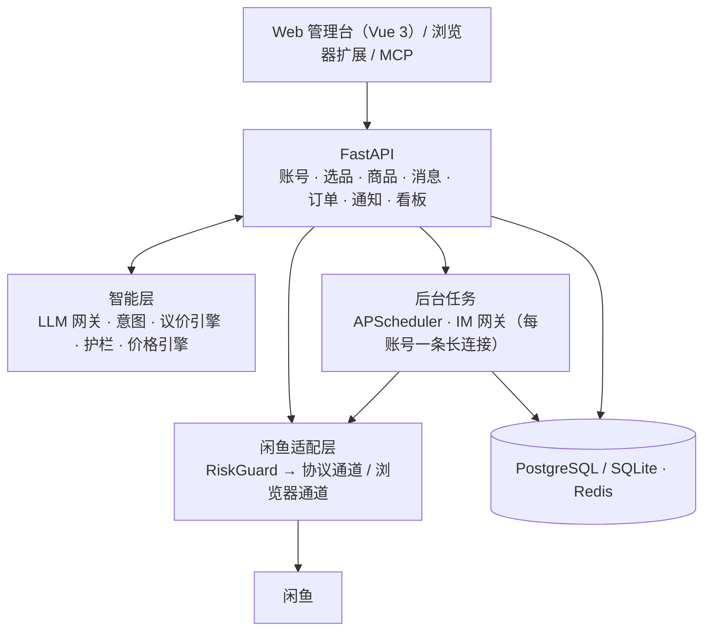

<div align="center">

# 🐟 XianyuHub · 鱼塘管家

**闲鱼买卖双端智能助手 —— 买家淘好货，卖家省心卖**

AI 选品雷达 · 统一收件箱 · 带底价护栏的 AI 客服 · 虚拟商品自动发货 · 风控内建 · MCP


</div>

> [!WARNING]
> 项目处于 **alpha** 阶段：功能已实现并有自动化测试覆盖，但闲鱼接口的字段与参数来自对网页版的观察，
> **尚未在真实账号上做长期验证**。首次使用请先用小号、默认的保守配置和“建议模式”观察一段时间。

---

## 目录

- [它能做什么](#它能做什么)
- [设计亮点](#设计亮点)
- [系统架构](#系统架构)
- [快速开始](#快速开始)
- [配置说明](#配置说明)
- [使用指南](#使用指南)
- [MCP 与浏览器扩展](#mcp-与浏览器扩展)
- [设计文档](#设计文档)
- [目录结构](#目录结构)
- [开发指南](#开发指南)
- [路线图](#路线图)
- [安全与合规](#安全与合规)
- [致谢](#致谢)
- [免责声明](#免责声明)

---

## 它能做什么

### 🛒 买家端：选品雷达

| 功能 | 说明 |
|---|---|
| **监控任务** | 多关键词；价格区间、省市、发布天数、个人闲置、包邮直接走接口参数筛选；cron 定时（间隔不少于 5 分钟） |
| **一句话建任务** | “想要 M1 Air，电池 90 以上，3500 以内，别要贩子” → AI 生成关键词、排除词和判定标准，确认后保存 |
| **两段式 AI 判定** | 先用规则和低成本文本粗筛淘汰明显不符的商品，再对候选商品补全详情（描述、全部图片、芝麻信用）做多模态判定 |
| **判定结果** | `推荐 / 有条件推荐 / 不推荐`，附理由、风险标签、需向卖家确认的点，以及可以直接发送的提问话术 |
| **卖家画像**（可选） | 卖家在售/已售商品、评价、好评率，辅助识别“个人玩家”还是“贩子”，缓存 24 小时 |
| **价格情报** | 剔除异常值后的市场价分位数、性价比评分（0–100）、价格快照与降价提醒 |
| **推送与看板** | 只推送值得看的商品；看板支持标记收藏 / 已看 / 不感兴趣 / 已买，导出 CSV |
| **失败保护** | 触发风控或连续失败 3 次自动暂停任务并通知，避免越跑越糟 |

### 🏪 卖家端：店铺中枢

| 功能 | 说明 |
|---|---|
| **商品中心** | 同步各账号商品；为每个商品设置底价、让价阶梯、最大议价轮次、赠品和客服知识库；擦亮、下架、每日自动擦亮 |
| **AI 生成发布草稿** | 只需上传图片（可加一句说明，如“1500 出，最低 1300”）→ AI 生成候选标题、描述、成色 / 瑕疵 / 配件、运费方式、客服知识库并挑选封面；售价和底价由代码按“卖家给的价格 > 同款行情 + 定价策略 > AI 估价”计算；描述里的站外联系方式、承诺性表述和“未说明”类句子会被自动删除 |
| **核对 → 确认 → 发布** | 确认页列出 AI 无法判断、需要你确认的事项，候选标题一键替换、按行情一键改价；发布前必须人工确认；支持定时发布；发布受账号级限流（默认每 5 分钟 1 个） |
| **统一收件箱** | 多账号会话聚合、实时推送（WebSocket）、网页端直接回复 |
| **自动回复流水线** | 注入防御 → 关键词规则（商品级 > 账号级 > 全局）→ 意图识别 → 议价引擎 → AI 措辞 → 输出护栏 → 模板兜底 / 转人工 |
| **商品知识库** | 长知识库按段落切分，按与买家问题的相关度（BM25）挑选段落给 AI，省 token 且不丢后面的内容 |
| **议价护栏** | 报价完全由代码计算，**底价不进入提示词**；回复中任何低于底价的金额、站外联系方式、“保证正品”类承诺都会被拦截 |
| **人工接管** | 卖家在 App / 网页亲自回复后该会话自动暂停 AI（持久化）；售后纠纷自动转人工并通知 |
| **三种模式** | 关闭 / 建议模式（AI 写候选，人工一键发送）/ 全自动；支持工作时段、合并连发消息、拟人延迟 |
| **自动发货** | 识别付款消息后**用订单接口二次校验**，按商品和规格找到对应的发货内容（固定内容 / 卡密库存 / 接口取货），发送后确认发货 |
| **发货风控** | 买家黑名单、同一买家 24 小时跨账号限购、退款冻结；失败按 1/2/5/10 分钟重试，重试不会重复发卡，超过次数转人工 |
| **库存与运营** | 卡密加密存储、导入去重、原子出库、缺货告警；可选自动评价 |

### 🧱 平台底座

扫码登录 / Cookie 导入 · 登录态探活与续期 · 账号健康度 · 每账号固定代理 · 令牌桶限流 · 风控熔断与指数退避冷却 ·
8 种通知渠道（企业微信 / 飞书 / 钉钉 / Telegram / Bark / ntfy / Webhook / 邮件）· 角色权限与账号授权 · 操作审计 ·
数据看板 · **协议自检**（用少量只读请求检查接口字段是否仍正确）· **模型接入**（多套 LLM 配置可前端切换，Key 加密存储）· 只读 MCP Server · 浏览器扩展 · 可选的 API / Worker 分离部署

---

## 设计亮点

1. **一个适配层管住所有闲鱼交互**（`backend/app/goofish/`）
   业务代码只调用 `search_items`、`get_order_detail`、`consign_virtual` 这类能力方法。底层默认走协议通道（mtop 签名 + IM 长连接），
   匿名搜索遇到风控时可降级到 Playwright 浏览器通道。接口变化时只需要改解析器和样本。
2. **风控是一等公民**
   每次调用都经过 `RiskGuard`：账号状态检查 → 按动作的令牌桶（单机内存 / 多实例 Redis）→ 随机抖动 → 登录、发布类操作账号互斥。
   识别到 `FAIL_SYS_USER_VALIDATE`、`RGV587`、`punish` 等信号**立即熔断并通知人工**，不做任何自动破解。
3. **AI 有护栏**
   AI 只负责理解和措辞；价格、发货、是否发送由规则决定。议价引擎有 1000 组随机用例的模糊测试，保证报价永不低于底价。
4. **买卖数据打通**：选品雷达积累的市场价同时用于卖家定价和竞品比价。
5. **安全基线**：所有接口强制鉴权；Cookie、代理、卡密、通知渠道配置用 AES-256-GCM 加密存储；默认只监听本机；凭证不发给任何第三方。

---

## 系统架构



| 组件 | 说明 |
|---|---|
| `backend` | FastAPI 应用。默认单进程模式：同一进程内运行调度器和 IM 网关 |
| `worker`（可选） | 分离部署时运行调度器、IM 长连接和订单处理，通过 Redis 与 API 进程同步事件、实时推送和 IM 操作 |
| `web` | Caddy：托管前端静态资源，反向代理 `/api` 与 WebSocket，配置域名后自动 HTTPS |
| `postgres` / `redis` | 业务数据；限流令牌桶（Lua 原子脚本） |

| 层 | 选型 |
|---|---|
| 后端 | Python 3.12 · FastAPI · Pydantic v2 · SQLAlchemy 2.0 async · Alembic · APScheduler · httpx · websockets · msgpack |
| 大模型 | Anthropic 官方 SDK（结构化输出 + 拒答回退）或任意兼容接口（Qwen / DeepSeek / Kimi / GLM / Ollama / vLLM）；在管理台「模型接入」配置与切换 |
| 前端 | Vue 3 · Vite · TypeScript · Element Plus · Pinia · ECharts |
| 部署 | Docker Compose · Caddy · PostgreSQL 16 · Redis 7 |

---

## 快速开始

### 方式一：Docker Compose（推荐）

环境要求：Docker 24+、2 核 4GB 内存。**建议部署在家庭网络 / NAS 或使用住宅代理**，机房 IP 更容易触发风控。

```bash
git clone https://github.com/ln2146/XianyuHub.git
cd XianyuHub/deploy
cp .env.example .env
# 必填：APP_SECRET_KEY、CREDENTIAL_MASTER_KEY、ADMIN_PASSWORD、POSTGRES_PASSWORD（生成命令见 .env 注释）
# 可选：LLM_API_KEY（不填则 AI 功能自动降级为仅规则）
vim .env
docker compose up -d --build
```

浏览器访问 `http://127.0.0.1:8080`，用 `.env` 中的管理员账号登录。

> 默认只监听本机。局域网访问把 `WEB_BIND` 改为 `0.0.0.0`；公网访问请填写 `SITE_ADDRESS=你的域名`，Caddy 会自动申请 HTTPS 证书。
> 国内网络拉取 Docker Hub 镜像不稳定时，可以配置镜像加速或重试。

### 方式二：本地开发运行

```bash
# 后端（http://127.0.0.1:8000，接口文档 /docs）
cd backend
uv sync --all-extras
cp .env.example .env          # 设置 ADMIN_PASSWORD 等
uv run python -m app

# 前端（http://localhost:5173，已代理 /api 到 8000；后端换端口时用 VITE_API_TARGET 指定）
cd frontend
pnpm install
pnpm dev
```

本地默认使用 SQLite（`backend/data/`），不需要 PostgreSQL 和 Redis。

### 可选：API 与 Worker 分离部署

默认单进程已能满足个人和小团队。需要把接口服务和后台任务分开（例如单独重启 API、或扩容 API 实例）时：

```bash
cd deploy
docker compose -f docker-compose.yml -f docker-compose.split.yml up -d --build
```

- `backend` 以 `PROCESS_ROLE=api` 运行，只提供接口；`worker` 以 `PROCESS_ROLE=worker` 运行调度器、IM 长连接和订单处理
- 两者通过 Redis 同步领域事件和实时推送；API 收到的“发送消息”等需要 IM 长连接的操作会交给 Worker 执行
- IM 长连接只能由一个 Worker 持有，**worker 请保持 1 个副本**；API 可以按需扩容

### 首次使用

1. **协议自检**（推荐）：「系统 → 协议自检」，先不选账号跑一次匿名检查，再选上账号检查登录态、IM 和订单接口。字段覆盖率明显偏低说明平台接口有变化，请先不要开启自动化。
2. **添加闲鱼账号**：「账号中心」→「扫码登录」，用闲鱼 App 扫码；需要身份验证时按提示在浏览器完成。也可以用浏览器扩展导出登录态后「导入 Cookie」。
3. **配置大模型**（要用 AI 功能时）：「模型接入」选择预设（DeepSeek / 通义 / Kimi / GLM / OpenRouter / Ollama 等）填入 API Key，点「测试连接」通过后保存并启用。可保存多套配置随时切换，多模态、对话、快速三个档位可分别指定模型；Key 加密保存且只显示打码值，修改接口地址或类型时需要重新填写 Key；AI 相关的判定与回复在模型不可用时会自动降级为仅规则。
4. **配置通知渠道**：「通知设置」添加企业微信 / 飞书 / Telegram 等，点「测试」确认能收到。
5. **按需开启功能**（所有自动化默认关闭）：
   - 买家：「选品雷达」新建任务，或用「一句话生成」
   - 卖家：「商品中心」同步商品并设置底价与知识库 →「账号中心」打开自动回复（建议先用**建议模式**）→「订单发货 → 自动发货」新建发货内容并关联商品后，再到账号设置打开自动发货

---

## 配置说明

完整配置见 [`deploy/.env.example`](deploy/.env.example)（Docker）和 [`backend/.env.example`](backend/.env.example)（本地）。常用项：

| 配置 | 默认 | 说明 |
|---|---|---|
| `APP_SECRET_KEY` | — | JWT 签名密钥，生产环境必须设置且不少于 32 位 |
| `CREDENTIAL_MASTER_KEY` | — | 32 字节 base64，加密 Cookie / 卡密，**丢失后无法解密，请备份** |
| `ADMIN_PASSWORD` | — | 首次启动创建管理员；生产环境不提供默认密码 |
| `LOCAL_AUTH` | `true` | 本机免登录：本机浏览器直接访问时跳过登录页；局域网 / 公网 / 经反向代理访问仍需密码，生产环境始终关闭 |
| `DATABASE_URL` | SQLite | 生产建议 PostgreSQL |
| `REDIS_URL` | 空 | 为空时使用进程内限流 |
| `PROCESS_ROLE` | `all` | `all` 单进程；`api` / `worker` 分离部署（需要 Redis） |
| `LLM_DEFAULT_PROVIDER` | `anthropic` | 兜底配置：管理台「模型接入」里没有任何启用配置时才生效 |
| `LLM_API_KEY` / `LLM_BASE_URL` | 空 | 同上；首次启动会把它们落成一套「环境变量配置」接入，之后在管理台改 |
| `LLM_MODEL_VISION / CHAT / FAST` | `claude-opus-5-5` | 分别用于多模态判定与文案、客服回复、意图分类与粗筛 |
| `LLM_DAILY_TOKEN_BUDGET` | `0` | 每日 token 上限，超出后自动降级为仅规则；接入配置里可单独覆盖 |
| `GUARD_RATE_MULTIPLIER` | `1.0` | 全局限流倍率，小于 1 更保守 |
| `GUARD_SEARCH_PER_MIN` / `GUARD_MESSAGE_PER_MIN` / `GUARD_PUBLISH_PER_5MIN` | 6 / 20 / 1 | 每账号的搜索、发消息、发布速率 |
| `GUARD_COOLDOWN_BASE_SECONDS` | `1800` | 风控熔断后的基础冷却时长（按次数指数增长，最长 6 小时） |
| `BROWSER_ENABLED` | `false` | 启用 Playwright 浏览器通道（Docker 构建时设置 `WITH_BROWSER=true`） |

账号级开关（自动回复、AI 模式、接管时长、工作时段、发货模式、自动评价、自动擦亮等）在管理台「账号中心 → 设置」中修改，即时生效。

---

## 使用指南

<details>
<summary><b>选品雷达：写好判定标准</b></summary>

判定标准写在任务的 `criteria` 中，建议包含三部分：

```markdown
## 必须满足（一票否决）
- M1 芯片的 MacBook Air；电池健康 ≥ 85%；无拆修
## 加分项
- 个人自用、有原盒发票、同城可面交
## 危险信号
- 价格远低于市场、只收全款不走验货、引导加微信
```

- 关键信息缺失时 AI 会给出“有条件推荐”，并生成可直接发给卖家的提问话术
- `rules` 用于不花 token 的硬条件过滤：`include_all`（标题必须包含）、`exclude`（排除词）、地区、最低芝麻信用等
- 只想按规则筛选不调用 AI：把判定方式设为 `rule`

</details>

<details>
<summary><b>AI 客服：议价策略怎么配</b></summary>

在「商品中心」为商品设置：

| 字段 | 示例 | 说明 |
|---|---|---|
| 底价 | 850 | **任何情况下都不会低于这个价格**，也不会出现在提示词里 |
| 最大轮次 | 3 | 超过后报最终价，不再让 |
| 让价阶梯 | 0.4 / 0.3 / 0.2 / 0.1 | 每轮让出 (标价 − 底价) 的比例 |
| 赠品 | 手机壳 | 用赠品代替降价 |
| 知识库 | 参数、瑕疵、使用说明 | AI 只依据这里和商品描述回答，不知道的会转人工 |

想要人数多的热门商品会自动减半让价。没有设置底价的商品，AI 不会给出任何低于标价的价格。
在收件箱里可以用「试运行」查看某条买家消息会得到什么回复，不会真正发送。

</details>

<details>
<summary><b>自动发货：发货内容与模板</b></summary>

入口：「订单发货 → 自动发货」。三步开启：① 新建发货内容 → ② 关联商品 → ③「账号中心 → 设置」打开自动发货。

| 发货方式 | 适用场景 | 说明 |
|---|---|---|
| 固定内容 | 教程、网盘链接 | 每单发送相同内容 |
| 卡密库存 | 激活码、兑换码 | 每行一张，导入自动去重，一卡一用，库存低于阈值告警 |
| 接口取货 | 对接自有系统 / 货源 | 配置 `url`、`method`、`headers`、`body`（支持变量）、`result_path` |

「发给买家的话」模板变量：`{content}` `{order_id}` `{buyer_name}` `{item_title}` `{spec}` `{quantity}`。
发货模式：先确认再发送 / 先发送再确认（默认）/ 只发送不确认。

</details>

<details>
<summary><b>遇到风控怎么办</b></summary>

账号状态变为「被平台限制」时，系统已自动暂停该账号的所有写操作并发出通知：

1. 打开通知或「账号中心」里的验证链接，在浏览器中完成滑块 / 身份验证
2. 回到管理台点击「我已完成验证」，账号进入「暂停保护中」，保护期结束后自动恢复
3. **不要**频繁重启服务或反复重试，这会延长风控时间

</details>

---

## MCP 与浏览器扩展

### MCP Server（只读）

让 Claude 等 AI 助手查询行情、选品结果、收件箱、订单，试运行客服回复，或把一句话需求转成监控任务草稿。
发送消息、发布、发货等写操作不开放，必须在管理台确认。

1. 管理台调用 `POST /api/v1/auth/api-token` 生成令牌（与当前用户同权限）
2. 在 MCP 客户端中配置：

```json
{
  "mcpServers": {
    "xianyuhub": {
      "command": "uv",
      "args": ["--directory", "/path/to/XianyuHub/backend", "run", "--extra", "mcp", "python", "-m", "app.mcp_server"],
      "env": { "XYH_BASE_URL": "http://127.0.0.1:8000", "XYH_TOKEN": "<令牌>" }
    }
  }
}
```

### 浏览器扩展

`extension/` 目录是一个 Chrome MV3 扩展：在 Chrome「扩展程序 → 开发者模式 → 加载已解压的扩展程序」中选择该目录。
登录 goofish.com 后点击扩展，可以复制登录态 JSON，或直接发送到你自己的鱼塘管家（需要 API 令牌）。

---

## 设计文档

项目启动前的调研与设计文档在 [`docs/design/`](docs/design/)：开源项目调研报告、产品功能清单、系统架构、核心业务流程图、风险合规与实施路线。

---

## 目录结构

```
XianyuHub/
├── backend/
│   ├── app/
│   │   ├── goofish/            # ★ 闲鱼适配层（唯一出入口）
│   │   │   ├── protocol/       #   mtop 签名与客户端、IM（LWP）长连接、扫码登录、编解码
│   │   │   ├── parsers/        #   搜索 / 详情 / 卖家 / 订单 / IM 消息解析
│   │   │   ├── guard/          #   令牌桶、风控守卫、动作策略
│   │   │   ├── gateway.py      #   能力门面 + 浏览器通道
│   │   │   └── publish.py      #   发布请求体
│   │   ├── intelligence/       # LLM 网关、议价引擎、护栏、价格引擎、意图、规则
│   │   ├── domains/            # account / buyer / goods / message / order / system
│   │   │                       #   system：用户 / 审计 / 看板 / 协议自检 / 模型接入（llm.py、llm_router.py）
│   │   ├── notify/             # 通知渠道
│   │   ├── workers/            # 调度器、IM 网关
│   │   ├── mcp_server.py       # MCP Server
│   │   └── main.py
│   ├── migrations/             # Alembic
│   └── tests/                  # 约 100 个测试（协议样本、模拟 IM 服务端、议价模糊测试、集群桥）
├── frontend/                   # Vue 3 管理台
├── extension/                  # 浏览器扩展
├── deploy/                     # docker-compose（含分离部署覆盖文件）、Caddyfile、.env.example
├── docs/design/                # 调研与设计文档
└── .github/workflows/ci.yml
```

---

## 开发指南

```bash
cd backend
uv sync --all-extras
uv run pytest -q                      # 运行测试
uv run ruff check app tests && uv run ruff format app tests
uv run alembic revision --autogenerate -m "说明"   # 修改模型后生成迁移
```

**开发约定**

- 与闲鱼交互的代码只能放在 `app/goofish/` 下，业务层禁止直接发 HTTP / WebSocket 请求
- 新增闲鱼接口时，同时提交：网关方法、解析器、脱敏后的响应样本（`tests/fixtures/`）和解析测试
- 写操作必须选择对应的 `Action`（决定限流与互斥），并写入审计日志
- AI 输出必须定义 Pydantic 模型；涉及价格或发货的决策必须由规则层给出
- 提交前确认没有包含任何真实 Cookie、Token、手机号或卡密

---

## 路线图

- [x] 闲鱼适配层：mtop 协议、IM 长连接、扫码登录、风控守卫、浏览器降级通道
- [x] 账号中心、通知中心、权限、审计
- [x] 选品雷达：监控任务、两段式 AI 判定、价格情报、降价提醒
- [x] 商品中心：同步、议价设置、AI 文案、智能定价、草稿发布、擦亮
- [x] 消息中心：统一收件箱、关键词回复、带护栏的 AI 客服、人工接管、建议模式
- [x] 订单发货：卡券库存、自动发货、发货风控、重试与告警
- [x] 数据看板、Docker 部署、MCP Server、浏览器扩展
- [x] 协议自检：只读检查接口与解析字段覆盖率
- [x] API / Worker 分离部署（Redis 集群桥）
- [x] 商品知识库相关度检索（BM25，无需向量模型）
- [ ] 在真实账号上长期验证接口字段与风控阈值（可借助协议自检逐步完成）
- [ ] 闲管家开放平台官方通道（需要商家开放平台的应用凭证）

---

## 安全与合规

- 定位为**个人或小团队管理自己账号的私有化效率工具**，不提供公共 SaaS 抓取服务
- 所有自动写操作默认关闭；建议先用“建议模式”观察
- 不内置任何验证码自动破解能力；遇到风控时由人工处理
- 卖家画像等数据只做短期缓存，供本人决策参考，**禁止导出、转售或公开**
- 回复中引导站外交易的内容会被默认拦截
- 发现安全问题请通过私密渠道报告，不要公开提交 Issue

---

## 致谢

本项目的设计参考了以下开源项目的思路（**净室实现，未复制其代码**）：

- [Usagi-org/ai-goofish-monitor](https://github.com/Usagi-org/ai-goofish-monitor)：多模态 AI 选品、判定标准体系、卖家画像
- [cv-cat/XianYuApis](https://github.com/cv-cat/XianYuApis)：闲鱼协议与 IM 通信研究
- [zhinianboke/xianyu-auto-reply](https://github.com/zhinianboke/xianyu-auto-reply)：自动回复与自动发货的业务设计
- [shaxiu/XianyuAutoAgent](https://github.com/shaxiu/XianyuAutoAgent)：多 Agent 客服与人工接管
- [superboyyy/xianyu_spider](https://github.com/superboyyy/xianyu_spider)：HTTP 直连搜索与筛选参数
- [fancyboi999/goofish-cli](https://github.com/fancyboi999/goofish-cli)：写操作限流、熔断与 Agent 化设计

---

## 免责声明

本项目仅供学习与研究使用。使用本项目访问闲鱼平台可能违反其用户协议，并可能导致账号受限或封禁，**由此产生的一切后果由使用者自行承担**。请遵守《中华人民共和国网络安全法》《个人信息保护法》《数据安全法》等法律法规及平台规则，不得将本项目用于任何违法违规用途。本项目与闲鱼、阿里巴巴集团无任何关联。

## License

待定。
