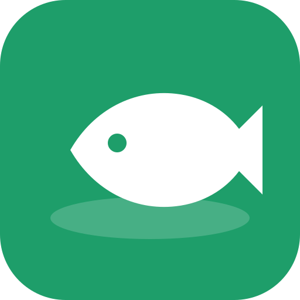
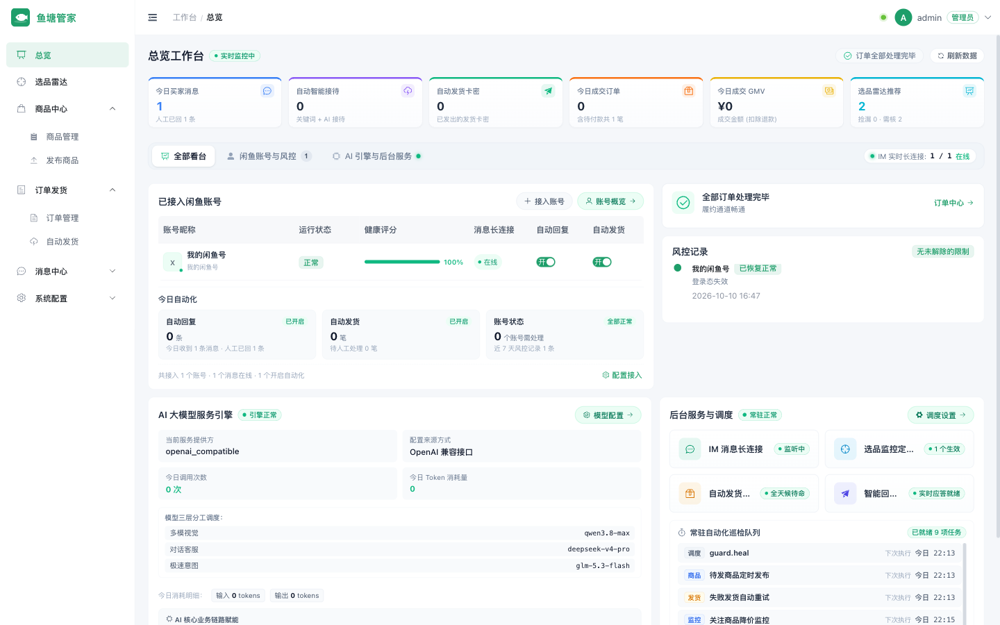
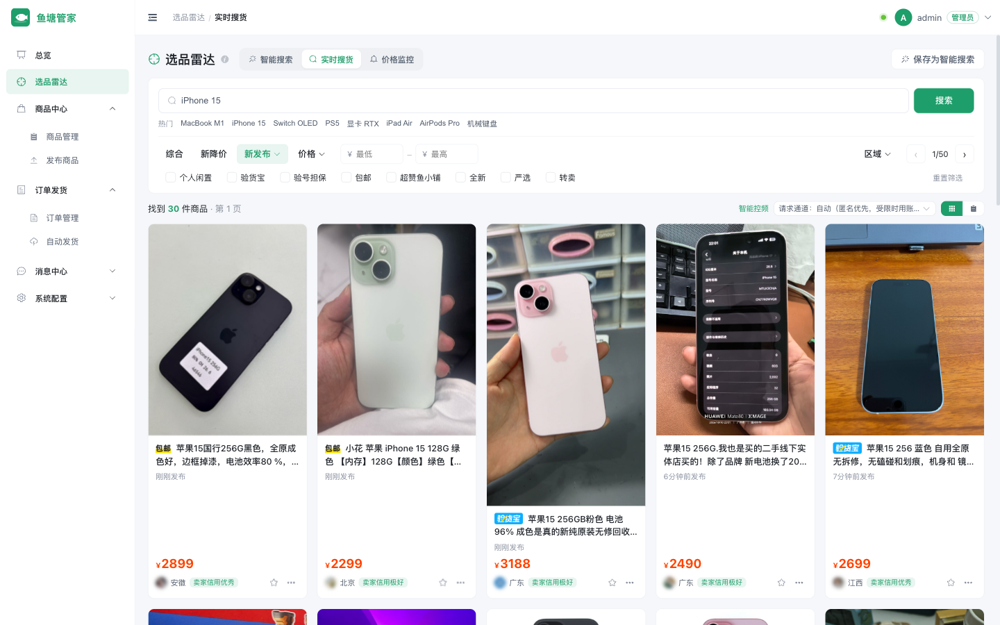
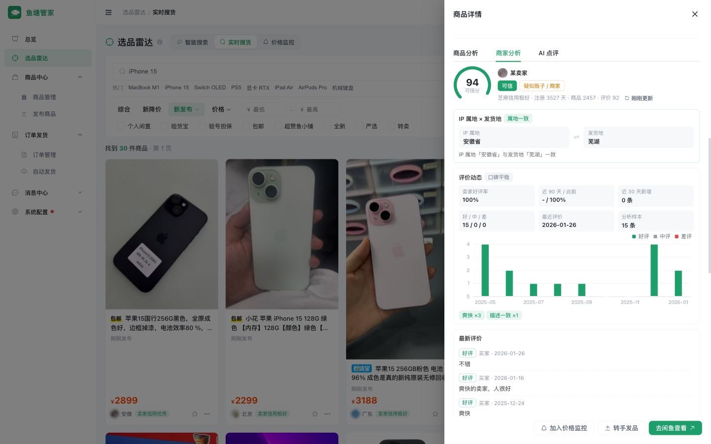
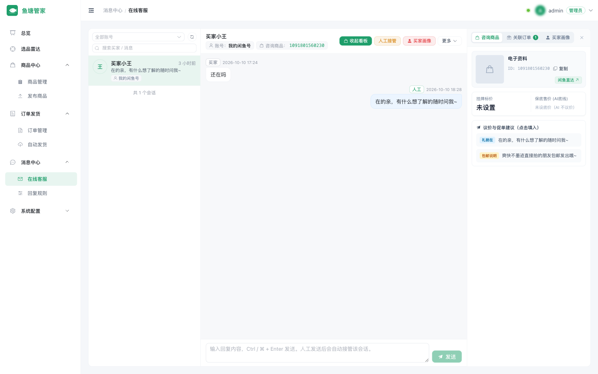
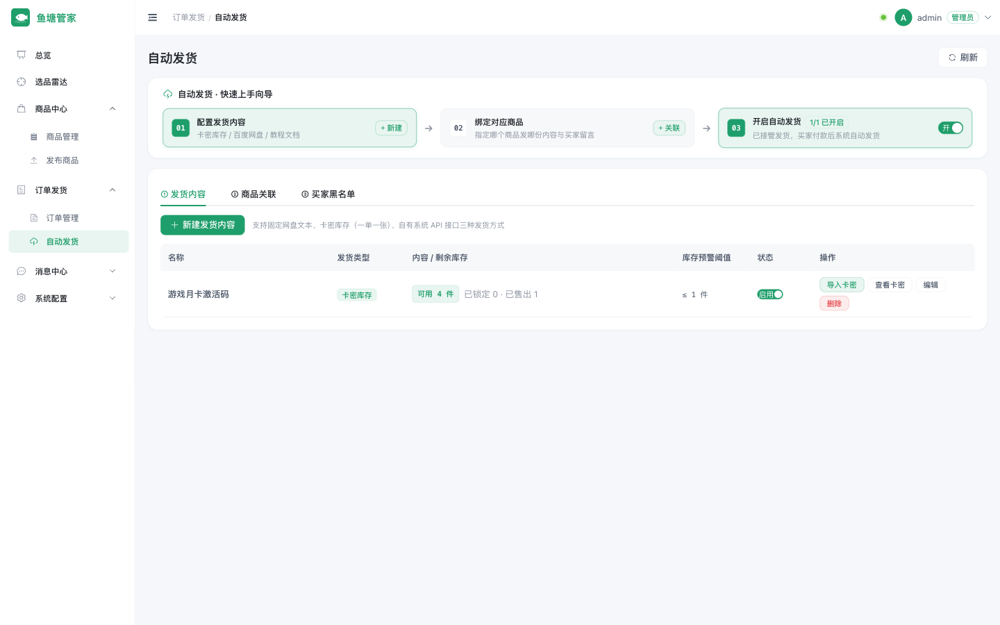
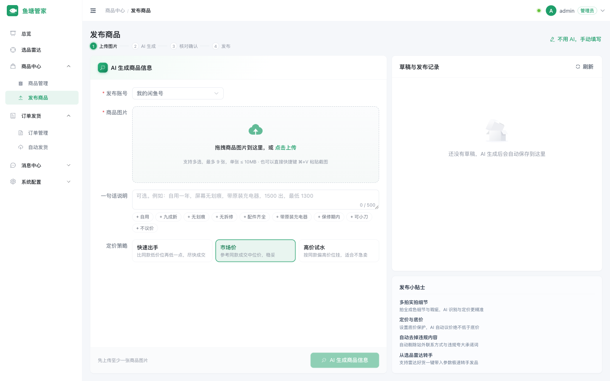
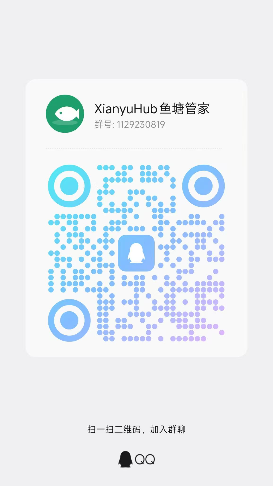

<div align="center">



# 鱼塘管家 XianyuHub

**自己部署的闲鱼助手：买家用它淘好货，卖家用它自动回复、自动发货。**

[](LICENSE)


[快速开始](#快速开始) · [功能一览](#功能一览) · [使用指南](docs/guide.md) · [部署与配置](docs/deployment.md) · [常见问题](#常见问题) · [交流群](#交流群)



</div>

## 为什么用它

闲鱼上买东西，要一遍遍刷新、比价、看卖家靠不靠谱；卖东西，要守着手机回“在吗”“最低多少”，买家付款后还得手动发卡密。

鱼塘管家把这些事交给程序做，并且**跑在你自己的电脑或 NAS 上**：登录态、聊天记录和卡密都留在本地，加密保存，不经过任何第三方服务。

- **买家**：AI 帮你盯货、比价、看卖家，只推送值得看的商品
- **卖家**：AI 客服守住底价回复买家，付款后自动发货，卖完还能自动重新上架
- **安全**：所有自动操作默认关闭，内置限流和风控熔断，出问题第一时间推送到你的微信

## 功能一览

### 选品雷达：别人还在刷，你已经收到推送



- **一句话建任务**：“3000 以内的 MacBook Air M1，电池 90 以上，不要贩子”，AI 自动拆成关键词、价格区间和判定标准，定时去搜
- **两段式 AI 判定**：先用规则粗筛，再看全部图片和描述做判断，给出 `推荐 / 需核验 / 不推荐`，附理由和该问卖家的问题
- **实时搜货**：筛选项与闲鱼网页版一致（新发布、价格、地区、个人闲置、验货宝、包邮……）
- **价格监控**：盯住看中的那一件，降到目标价立刻提醒

### 商品与商家分析：这个价划不划算，这个人靠不靠谱



- **商品分析**：同类价格分位、性价比评分、价格走势、描述是否交代了成色和配件、可疑低价识别
- **商家分析**：IP 属地与发货地是否一致、芝麻信用与账号年限、评价动态（好评率、口碑趋势、**短期集中刷评**、评价过少）、是不是二手贩子
- **AI 点评**：综合以上给出买不买的建议

### AI 客服：守得住底价的自动回复



- **统一收件箱**：多个闲鱼号的会话集中处理，侧栏直接看商品、订单和买家画像
- **议价引擎**：报价由代码计算，**底价不进提示词**；回复里任何低于底价的金额、站外联系方式、“保证正品”类承诺都会被拦截
- **三种模式**：关闭 / 建议（AI 写好你一键发）/ 全自动，由你为每个账号选择；支持关键词规则、工作时段、拟人延迟
- **教 AI 了解你的店**：写一段说明（店铺情况、语气、发货规则），再上传说明书、FAQ、价目表（pdf / docx / txt），AI 只挑与问题相关的段落作答；开启前可以先试运行看效果
- **该你出手时会叫你**：售后纠纷、AI 拿不准、你接管期间买家又来消息，都会推送提醒
- **买家画像**：识别“到手刀”、恶意砍价、索要站外联系方式，帮你判断要不要卖

### 自动发货：卖虚拟商品不用守着手机



- **三种发货方式**：固定内容（网盘 / 教程）、卡密库存（一单一张）、对接你自己系统的接口取货
- **防骗**：必须由闲鱼订单接口确认“已付款”才发货，买家手打假付款通知骗不到卡密
- **防重**：同一买家限购、并发付款只放行一单；发送结果拿不准时不退回卡密，转人工核对，避免一码两卖
- **卖完自动重新上架**：网页端只能挂 1 件库存，开启后每卖完一件自动发布一件同样的新商品

### 发布商品：传几张图，剩下交给 AI



- AI 识图生成标题、描述、成色、运费方式和客服知识库，按同款行情给出定价
- 发布前逐项核对 AI 标出的待确认信息；支持定时发布、选择宝贝所在地
- 闲鱼要求身份认证时直接弹出扫码窗口，认证后自动重发

### 还有这些

扫码登录与登录态保活 · 每账号独立代理 · 令牌桶限流与风控熔断（到期自动恢复）· 掉线 / 受限 / 断线告警 ·
10 种通知渠道（Server酱、PushPlus 推送到微信，企业微信 / 飞书 / 钉钉 / Telegram / Bark / ntfy / Webhook / 邮件）·
多套大模型配置随时切换（DeepSeek、通义、Kimi、GLM、Claude、Ollama…）· 协议自检 · 多用户与账号授权 · 操作审计 ·
只读 [MCP Server](docs/guide.md#mcp-server只读) · [浏览器扩展](docs/guide.md#浏览器扩展)

## 快速开始

需要 Docker 24+。建议部署在家庭网络或 NAS 上，机房 IP 更容易触发闲鱼风控。

```bash
git clone https://github.com/ln2146/XianyuHub.git
cd XianyuHub/deploy
cp .env.example .env    # 填写管理员密码和密钥，生成命令见文件内注释
docker compose up -d --build
```

打开 `http://127.0.0.1:8080` 登录，然后：

1. **账号配置** → 扫码登录你的闲鱼号
2. **通知设置** → 接一个微信推送（Server酱 / PushPlus），出问题第一时间知道
3. **模型配置** → 填入任意大模型的 API Key（不填也能用，AI 功能会降级为规则）
4. 按需打开选品雷达、自动回复、自动发货（**全部默认关闭**，建议先用“建议模式”观察几天）

本地开发、分离部署和全部配置项见 [部署与配置](docs/deployment.md)。

## 常见问题

<details>
<summary><b>会不会被封号？</b></summary>

有风险，任何第三方工具都无法保证。鱼塘管家尽量降低风险：每个操作都限速并加入随机延迟，识别到滑块或安全验证立即暂停该账号、等你人工处理，从不尝试自动破解；自动消息会拦截站外导流内容。建议先用小号和默认的保守配置试用。

</details>

<details>
<summary><b>必须接大模型吗？要花多少钱？</b></summary>

不是必须。不配置时，选品按规则筛选、客服只用关键词回复，其余功能照常。接入后可以用 DeepSeek、通义等国产模型，个人日常使用的费用通常很低；还可以设置每日 token 上限，超出自动降级为规则。

</details>

<details>
<summary><b>电子资料能设置库存吗？</b></summary>

闲鱼网页版对多数个人账号不开放库存，所以从管理台发布只能挂 1 件。两个办法：在闲鱼 App 发布并设置库存，系统会同步并自动发货；或者打开「卖完自动重新上架」。

</details>

<details>
<summary><b>支持多个闲鱼号吗？</b></summary>

支持。每个账号独立的登录态、代理、限流和自动化开关，收件箱和订单集中管理；还可以把账号授权给团队成员。

</details>

<details>
<summary><b>实物商品能自动发货吗？</b></summary>

暂时不能。目前只支持虚拟商品的“无需物流”发货；选择快递、填写运单号还在路线图上。

</details>

## 交流群

使用中遇到问题、有功能建议，或者想和其他卖家交流经验，欢迎加入 QQ 群 **1129230819**。



## 免责声明

本项目仅供学习与研究使用，定位为个人或小团队管理**自己账号**的效率工具，不提供公共抓取服务。使用本项目访问闲鱼可能违反其用户协议，并可能导致账号受限或封禁，**由此产生的一切后果由使用者自行承担**。请遵守《网络安全法》《个人信息保护法》《数据安全法》等法律法规及平台规则，不得用于任何违法违规用途。卖家画像等数据仅做短期缓存供本人参考，禁止导出、转售或公开。本项目与闲鱼、阿里巴巴集团无任何关联。

## 开源协议

[MIT](LICENSE)
