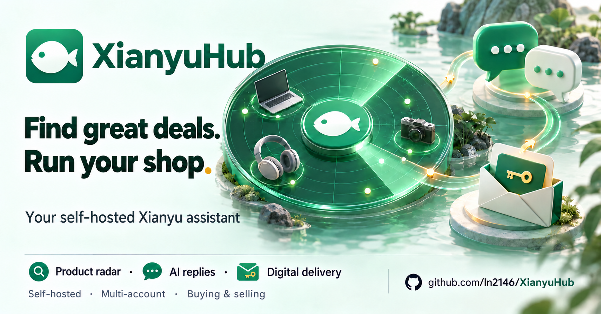
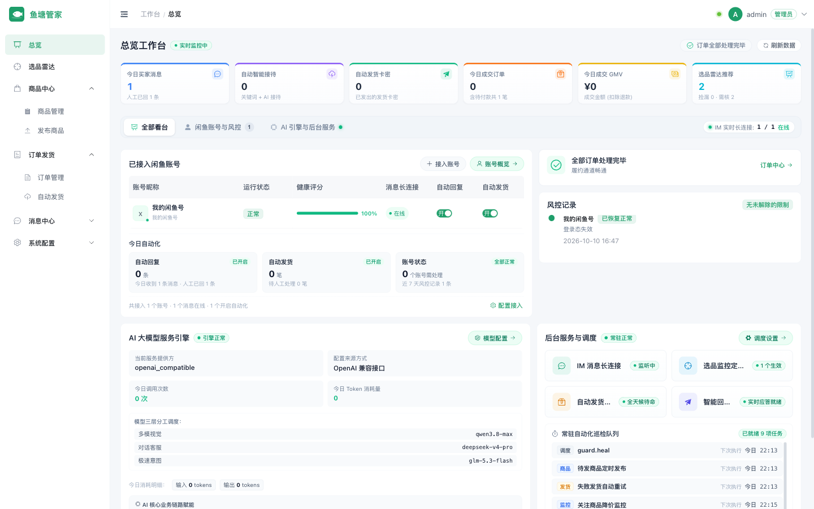
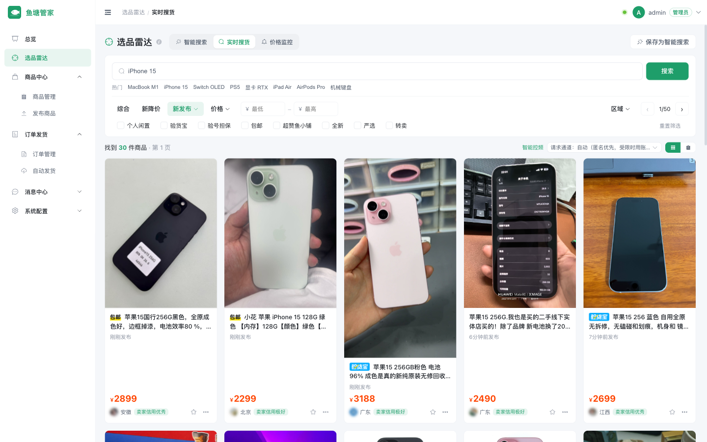
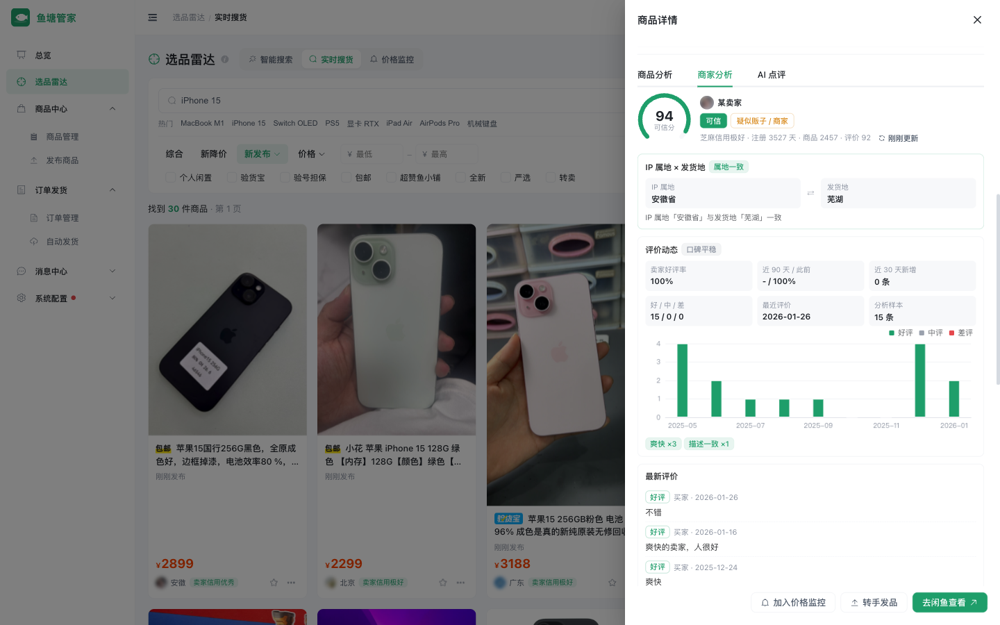
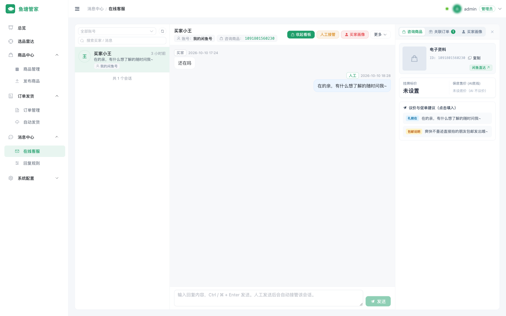
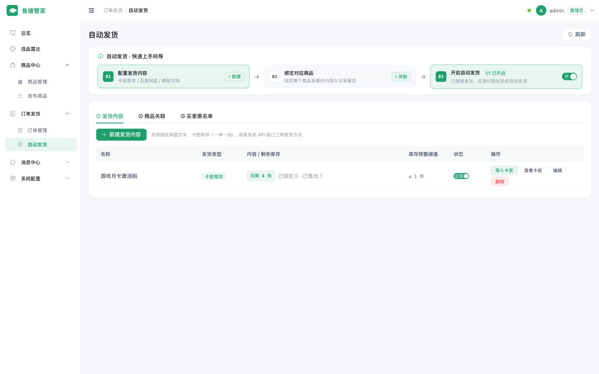
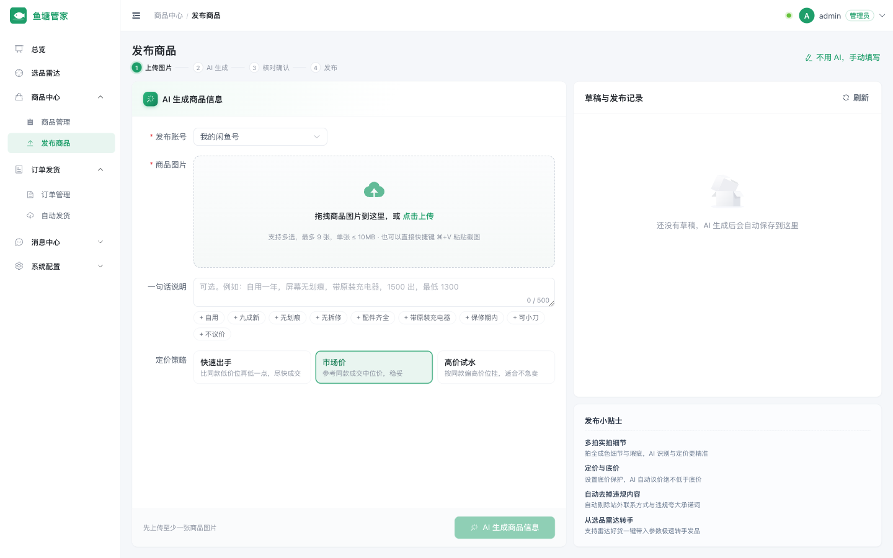
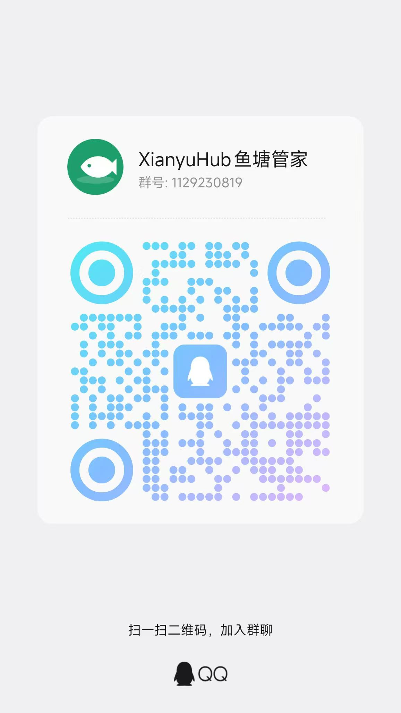

<div align="center">



# XianyuHub

**Find great deals. Run your shop.**

A self-hosted Xianyu assistant for buyers tracking deals and sellers managing conversations and digital delivery.

[中文](README.md) · [**English**](README_EN.md)

[](LICENSE)


[Overview](#overview) · [Video](#video) · [Quick start](#quick-start) · [Features](#features) · [User guide](docs/guide.md) · [Deployment](docs/deployment.md) · [FAQ](#faq) · [Community](#community)

</div>

## Overview

**XianyuHub is a self-hosted Xianyu assistant for individuals and small teams, running on your own computer or NAS.** Bring conversations, listings and orders from multiple accounts into one workspace, with less repetitive searching, replying and digital delivery.

- **For buyers**: schedule product searches, track prices and assess listings with product and seller analysis.
- **For sellers**: manage conversations, use AI customer replies, publish listings and automatically deliver virtual goods.
- **Automation on your terms**: choose off, suggested replies or fully automatic mode per account, and connect your preferred model provider and notification channels.

This is an unofficial, community-maintained project. Automated actions are disabled by default. Physical-goods shipments still require entering tracking information in the Xianyu mobile app.

## Video

XianyuHub — Find great deals. Run your shop.

https://github.com/user-attachments/assets/9ca97e36-2c26-4197-a4b3-8918a8c9f94f

## Quick start

Requires Docker 24+. A home network or NAS is recommended; data-center IP addresses are more likely to trigger Xianyu's risk controls.

```bash
git clone https://github.com/ln2146/XianyuHub.git
cd XianyuHub/deploy
cp .env.example .env    # Set the admin password and secrets; generation commands are in the file comments
docker compose up -d --build
```

Open `http://127.0.0.1:8080`, sign in, then:

1. **Accounts**: scan the QR code to sign in to your Xianyu account.
2. **Notifications**: configure a channel such as ServerChan or PushPlus for WeChat alerts.
3. **Models**: enter your model provider's API key. Without one, AI features use rule-based behavior.
4. Enable product radar, automatic replies or delivery as needed. **All automation is disabled by default**; start with suggested replies while observing behavior.

See [Deployment and configuration](docs/deployment.md) for local development, separate deployment and configuration details.

## Features

Automated actions start disabled, with rate limiting, risk circuit breakers and alerts through your configured channels. See the feature details and FAQ below.

<p align="center">
  
</p>

The video, screenshots and detailed guides currently use Chinese.

### Product radar: let useful listings come to you



- **Create a task in one sentence**: describe a budget and requirements, such as a MacBook Air M1 under CNY 3,000 with battery health above 90%, excluding resellers. AI turns the request into keywords, price ranges and evaluation criteria for scheduled searches.
- **Two-stage evaluation**: filter with rules first, then analyze images and descriptions. Results include `Recommended / Needs verification / Not recommended`, reasons and questions to ask the seller.
- **Live search**: use filters matching Xianyu's web interface, including recent listings, price, location, personal items, inspection service and free shipping.
- **Price tracking**: watch a specific item and receive an alert when it reaches your target price.

### Product and seller analysis: assess the deal and the seller



- **Product analysis**: comparable-price percentiles, value scores, price trends, condition and accessory disclosures, and suspiciously low prices.
- **Seller analysis**: IP region versus shipping location, Sesame Credit and account age, review history, positive-review rate, reputation trends, concentrated review bursts, limited review history and reseller indicators.
- **AI assessment**: combine these signals into a buying recommendation.

### AI customer service: replies that respect your minimum price



- **Unified inbox**: handle conversations from multiple accounts, with product, order and buyer context in the sidebar.
- **Negotiation engine**: prices are calculated in code; **the minimum price is not included in the prompt**. Replies containing below-floor amounts, off-platform contact information or claims such as "guaranteed genuine" are blocked.
- **Three modes**: off, suggested replies for you to send, or fully automatic. Choose per account, with keyword rules, optional images, working hours and response delays.
- **Presale versus after-sales**: general questions about returns are answered normally; refund requests from buyers with an order are handed to a human.
- **Negotiation limits**: when an item has no individual floor price, apply account-level limits on percentage discounts, absolute discounts and negotiation rounds. You can also set prohibited AI wording.
- **Store knowledge**: describe your shop, tone and delivery rules, then upload manuals, FAQs or price lists in PDF, DOCX or TXT format. AI selects relevant passages, and you can try replies before enabling automation.
- **Human handoff**: receive alerts for disputes, uncertain answers, handoff keywords or new messages while you are handling a conversation. Blacklisted buyers do not receive automatic replies.
- **Buyer insights**: identify patterns such as demands for discounts after delivery, aggressive bargaining and attempts to obtain off-platform contact details.

### Automated delivery: virtual goods without watching your phone



- **Three delivery methods**: fixed content such as a download link or tutorial, a code inventory with one code per order, or goods retrieved from your own API. Delivery can include images such as redemption QR codes.
- **Payment verification**: the Xianyu order API must confirm payment before delivery. A buyer's typed payment message does not trigger fulfillment.
- **Duplicate protection**: purchase limits and concurrent-payment handling prevent duplicate fulfillment. If the sending result is uncertain, the code is held for manual review instead of returned to inventory.
- **Automatic relisting**: when enabled, publish a matching replacement listing after an item sells, for workflows where the web interface only permits one item in stock.

### Listing creation: start with a few photos



- AI analyzes images to draft the title, description, condition, shipping method and customer-service knowledge, with a price suggestion based on similar listings.
- Review flagged information before publishing. Scheduled publishing and item-location selection are supported.
- If Xianyu requires identity verification, a QR-code window appears. Publishing is retried after verification.

### More capabilities

QR-code login and session maintenance · Per-account proxies · Token-bucket rate limiting and risk circuit breakers with timed recovery · Offline, restriction and connection alerts ·
10 notification channels: ServerChan, PushPlus, WeCom, Feishu, DingTalk, Telegram, Bark, ntfy, Webhook and email ·
Switchable model configurations, including DeepSeek, Qwen, Kimi, GLM, Claude and Ollama · Protocol self-checks · Multiple users and account permissions · Audit logs ·
A read-only [MCP server](docs/guide.md#mcp-server只读) · A [browser extension](docs/guide.md#浏览器扩展).

## FAQ

<details>
<summary><b>Where is data stored, and what is sent to external services?</b></summary>

The database is stored locally. Sensitive fields such as cookies, digital codes and notification-channel credentials are encrypted; business data such as conversations and listing content is not encrypted across the entire database. When AI is enabled, relevant product information, images and portions of conversation context are sent to your configured model provider. Notifications are sent through the channels you configure. Xianyu operations still communicate with the Xianyu platform.

</details>

<details>
<summary><b>Could my account be restricted or banned?</b></summary>

Yes. No third-party tool can guarantee otherwise. XianyuHub limits operation rates, adds randomized delays and pauses an account when a slider or security check appears, leaving verification to you. It does not attempt to solve these challenges automatically, and automatic replies block off-platform redirection. Start with a secondary account and conservative settings.

</details>

<details>
<summary><b>Do I need an AI model, and what does it cost?</b></summary>

An AI model is optional. Without one, product discovery uses rules and customer service uses keyword replies; other features remain available. Costs depend on the provider and usage. A daily token limit is available, with rule-based behavior after that limit is reached.

</details>

<details>
<summary><b>Can I set stock for digital goods?</b></summary>

Xianyu's web interface does not expose inventory settings for most personal accounts, so listings created from the management panel have a stock quantity of one. You can set inventory in the Xianyu mobile app and let XianyuHub synchronize orders and delivery, or enable automatic relisting after each sale.

</details>

<details>
<summary><b>Can I manage multiple Xianyu accounts?</b></summary>

Yes. Each account has its own session, proxy, rate limits and automation settings. Conversations and orders are handled centrally, and account access can be granted to team members.

</details>

<details>
<summary><b>Can physical goods be shipped automatically?</b></summary>

Not fully: Xianyu's web interface does not support entering a tracking number, so shipment must be completed in the mobile app. XianyuHub sends a pending-shipment notification after payment and lets you copy shipping information from the order manager. Scan a QR code in the Xianyu app to open the order's shipping page and enter the tracking number. Another reminder is sent after 24 hours without shipment, and order status synchronizes after you ship.

</details>

## Community

For questions, suggestions and discussions with other sellers, join the QQ group: **1129230819**.



## Copyright and terms of use

This project is licensed under the [GNU Affero General Public License v3.0 (AGPL-3.0)](LICENSE). Copyright © 2026 ln2146. It is intended as a learning and research tool for individuals and small teams managing **their own accounts**. Do not use it for unlawful activities.

When using, modifying, distributing or offering the software as a network service, comply with AGPL-3.0 requirements, including source availability and preservation of copyright notices. Users are responsible for deployment, configuration and operation, and for complying with applicable law and platform rules, including relevant cybersecurity, personal-information and data-security laws. Seller-profile data is for personal reference only; do not export, resell or publish it.

This is an unofficial, community-maintained project. It is not affiliated with, authorized by, endorsed by or partnered with Xianyu, Alibaba or their affiliates. Accessing Xianyu through this project may violate its terms and may result in account restrictions or bans. Platform APIs, risk controls and page structures can change at any time; maintainers do not guarantee uninterrupted operation when those changes occur.

The project is provided "as is", without express or implied warranties. Users bear the risks, losses and responsibilities arising from its use.
