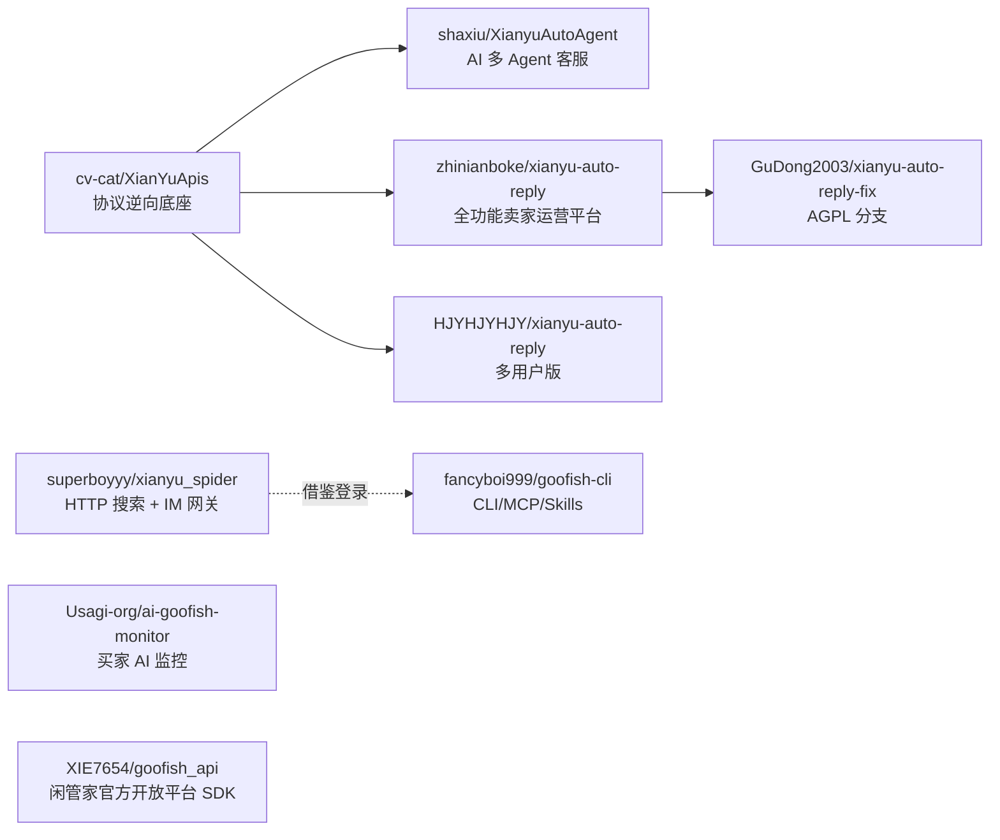

# 01 · 闲鱼开源项目调研报告

> 调研时间：2026-10-08
> 调研方式：将仓库浅克隆后只读阅读源码（未运行任何代码），并结合 GitHub 元数据与 Issue 讨论
> 文中的 star 数、最后更新时间均为调研当日的数据

---

## 1. 总览：五个指定项目的定位对比

| 项目 | Stars | 协议 | 面向 | 核心能力 | 取数 / 交互方式 | 一句话评价 |
|---|---|---|---|---|---|---|
| [Usagi-org/ai-goofish-monitor](https://github.com/Usagi-org/ai-goofish-monitor) | 14.7k | MIT | **买家** | 多任务监控 + 多模态 AI 判定 + 推送 | Playwright 驱动真实浏览器，拦截页面发出的 mtop 响应 | 买家选品方向工程化程度最高，Prompt 体系和卖家画像设计值得借鉴 |
| [cv-cat/XianYuApis](https://github.com/cv-cat/XianYuApis) | 1.5k | 无 LICENSE 文件 | 开发者 | 协议 SDK：扫码登录、IM 收发、商品详情、图片上传、发布商品 | 直接调用 mtop HTTP 接口 + 钉钉 IMPaaS WebSocket | 几乎所有自动回复项目的协议源头 |
| [zhinianboke/xianyu-auto-reply](https://github.com/zhinianboke/xianyu-auto-reply) | 7.5k | AGPL-3.0，另声明“禁止商用” | **卖家**（虚拟货源） | 多账号、关键词/AI 回复、自动发货、确认发货、评价、擦亮、发布、分销 | 协议直连 + Playwright 过滑块 | 卖家方向功能最全，但体量庞大、二次开发成本高 |
| [shaxiu/XianyuAutoAgent](https://github.com/shaxiu/XianyuAutoAgent) | 9.3k | GPL-3.0 | **卖家** | 多 Agent 客服：意图路由、议价、技术问答、人工接管 | 协议直连（基于 XianYuApis） | 代码约 2000 行，是 AI 客服的教学级参考 |
| [superboyyy/xianyu_spider](https://github.com/superboyyy/xianyu_spider) | 871 | README 写 MIT 但无 LICENSE 文件，并声明“不得商用” | 开发者 | 搜索 API 化、扫码登录、IM 网关（SSE） | httpx 直连 mtop，匿名即可搜索 | 轻量、速度快，适合替代浏览器做取数 |

**项目谱系**：

---

## 2. 逐项深度分析

### 2.1 ai-goofish-monitor（买家选品 / 监控）

**技术栈**

- 后端：FastAPI + APScheduler（时区 Asia/Shanghai）、`openai` SDK（AsyncOpenAI）、SQLite
- 采集：Playwright async（本地使用 Chrome/Edge，Docker 内使用 Chromium）
- 前端：Vue 3 + Vite + Tailwind + shadcn-vue，支持中英文
- 部署：三阶段构建的 Dockerfile，镜像为 `ghcr.io/usagi-org/ai-goofish`

**关键设计**

| 模块 | 文件 | 要点 |
|---|---|---|
| 采集 | `src/scraper.py` 中的 `scrape_xianyu()`、`scrape_user_profile()` | 不解析 DOM，而是用 `page.expect_response` 截获以下 mtop 接口的响应：`idlemtopsearch.pc.search`（搜索）、`idle.pc.detail`（详情）、`user.page.head`、`xyh.item.list`、`trade.rate.list`（卖家主页与评价） |
| 筛选 | `scraper.py` | 通过模拟 UI 点击完成“新发布 / 个人闲置 / 包邮 / 省市区 / 价格区间”筛选，所以**依赖 DOM 选择器**，页面改版就会失效 |
| 卖家画像 | `src/parsers.py` 中的 `calculate_reputation_from_ratings` | 采集卖家的全部在售/已售商品和全部评价，分别计算作为卖家、作为买家的好评率 |
| AI 判定 | `src/ai_handler.py`、`src/ai_message_builder.py` | 图片转成 base64 传给多模态 LLM，同时附上商品 JSON 和判定标准；兼容 Chat Completions 与 Responses API；temperature 设为 0.1 |
| Prompt 体系 | `prompts/base_prompt.txt`、`prompts/macbook_criteria.txt` | 基础模板（定义输出 JSON 格式）+ 品类判定标准，后者通过 `{{CRITERIA_SECTION}}` 注入。判定规则：**画像优先**（识别贩子）、**一票否决**、**图片优先于文字**、**信息缺失时标记 NEEDS_MANUAL_CHECK** |
| 自然语言建任务 | `src/prompt_utils.py` 中的 `generate_criteria()` | 用户用一句话描述需求，LLM 以 macbook 的判定标准为范例，生成新品类的判定标准 |
| 价格参考 | `src/services/price_history_service.py` | 保存价格快照，计算市场均价/中位数，给出 `deal_score`（0–100）性价比分 |
| 风控 | `src/failure_guard.py`、`src/rotation.py` | 伪装指纹并随机延时；**检测到滑块即放弃，不尝试破解**；任务级熔断，cookie 文件 mtime 变化后自动恢复；账号池与代理池轮换，失败的账号或代理加入 TTL 黑名单 |
| 登录态 | `chrome-extension/` | 用 MV3 浏览器扩展导出 cookie 以及 UA、屏幕、时区等环境快照，导入后还原到 Playwright context |
| 通知 | `notification_clients/` | ntfy、Gotify、Bark、企业微信机器人、Telegram、通用 Webhook |

**采集的数据字段**：标题、现价、原价、想要人数、浏览量、标签（包邮/验货宝）、发货地区、发布时间、图片列表、卖家昵称、芝麻信用、注册天数、卖家在售/已售商品、评价。
**缺口**：不采集商品描述正文 `itemDO.desc`。

**问题**

- 吞吐低：每个商品都要打开详情页和卖家主页，并且有大量 sleep。
- AI 成本高：每个商品都附带多张图片调用多模态模型。
- **安全问题**：`/api/*` 路由没有服务端鉴权，`GET /api/accounts/{name}` 会直接返回 cookie 全文；默认账密为 admin/admin123。部署到公网等于泄露闲鱼账号。

### 2.2 XianYuApis（协议底座）

**依赖**：Python + Node（通过 PyExecJS 调用逆向得到的 JS）。

**mtop 网关**

- 地址：`https://h5api.m.goofish.com/h5/{api}/{v}/`
- 公共参数：`jsv=2.7.2`、`appKey=34839810`
- 签名：`sign = md5(token & t & 34839810 & data)`，其中 token 取 cookie `_m_h5_tk` 中下划线之前的部分

**关键 cookie**：`_m_h5_tk`（签名用）、`unb`（用户 ID）、`cookie2`、`cna`、`sgcookie`、`tfstk`

**扫码登录流程**：`mini_login.htm` 获取 XSRF → `qrcode/generate.do` → 轮询 `qrcode/query.do`（NEW→SCANNED→CONFIRMED）→ `login_token/login.do`

**IM 协议**（钉钉 IMPaaS 的 LWP 协议）

| 环节 | 细节 |
|---|---|
| 连接 | `wss://wss-goofish.dingtalk.com/` |
| 取 accessToken | 调用 `mtop.taobao.idlemessage.pc.login.token`，data 中 IM appKey 为 `444e9908a51d1cb236a27862abc769c9`，deviceId 为 `UUID-unb` |
| 注册 | 发送 `/reg`，随后发送 `/r/SyncStatus/ackDiff` |
| 心跳 | 每 15 秒发送一次 `/!` |
| ACK | 收到每一帧都要回 `{code:200, headers:{mid,sid}}` |
| 收消息 | 内容位于 `syncPushPackage.data[0].data`，先 base64 解码，再做 **MessagePack** 解码（README 写的是 Protobuf，与实际不符） |
| 发消息 | `/r/MessageSend/sendByReceiverScope`，`contentType=101`，`custom.data` 为 base64 编码的 JSON（type 1 为文字，2 为图片） |
| 建会话 / 拉历史 | `/r/SingleChatConversation/create`、`/r/MessageManager/listUserMessages` |

**卖家相关 API**

- `idle.pc.detail`：商品详情
- `stream-upload.goofish.com/api/upload.api`：图片上传
- `idle.kgraph.property.recommend`：类目与属性推荐
- `idle.local.poi.get`：地址
- `mtop.idle.pc.idleitem.publish`：发布商品

**不足**

- 属于示例级代码：异常被吞掉，没有断线重连，签名每次都要启动 Node（签名本身只是 MD5，完全可以用纯 Python 实现）
- `requirements.txt` 中依赖缺失
- 没有 LICENSE 文件，**代码不可直接复制使用**

### 2.3 xianyu-auto-reply（卖家全功能运营）

**架构**：通过 6 容器 docker-compose 部署：

| 容器 | 职责 |
|---|---|
| backend-web（8089） | 约 75 个路由 |
| websocket（8090） | 每个账号一个 `XianyuAsync` 实例 |
| scheduler（8091） | 约 25 个定时任务 |
| frontend（9000） | React 18 前端 |
| mysql、redis | 存储与缓存 |

另有 Expo 移动端和返佣子系统。

**值得借鉴的业务设计**

| 领域 | 实现要点 |
|---|---|
| 统一 mtop 客户端 | `common/services/xianyu_mtop.py::mtop_call`：TOKEN_EXPIRED 时合并 Set-Cookie 后重签名，最多重试 3 次；SESSION_EXPIRED 时让账号冷却，并触发密码登录；`FAIL_SYS_USER_VALIDATE / RGV587 / punish` 等风控错误返回 punish_url，由调用方处理 |
| 自动回复优先级 | 系统消息过滤 → 去重窗口 → 人工回复后暂停 → 关键词（商品级规则优先于通用规则，image > 外部联系方式 > text，同类按命中长度排序）→ AI → 默认回复（可设置只回一次） |
| 付款识别 | 依靠系统消息文案：`[我已付款，等待你发货]`、`[已付款，待发货]`、`[记得及时发货]`；订单号从 dxCard 的 targetUrl 中用正则提取 `orderId=`，再调用 `idle.web.trade.order.detail` 补全订单信息 |
| 发货前风控 | `delivery_rules/` 中的规则：买家信用阈值、同一买家重复下单、跨账号薅羊毛、存在未确认收货订单、三级黑名单；命中后提示买家，或调用 `close.by.seller` 关单 |
| 卡券库存 | `xy_cards` 有四种类型：text（固定文本）、data（卡密库存，每行一条，用 CAS 或 `SELECT FOR UPDATE` 原子出库）、image（图片）、api（外部接口取货，支持 `{order_id}` 等变量）；支持多规格，可设置延时发送 |
| 确认发货 | 调用 `mtop.taobao.idle.logistic.consign.dummy` 做虚拟发货；小刀订单先调用 `groupon...freeshipping` 免拼；支持三种模式：先确认再发卡 / 发卡后确认 / 只发卡 |
| 卖家 API 全集 | 发布/编辑/删除/下架/查询自己的商品、擦亮 `idle.item.polish`、订单 `merchant.sold.get`、退款列表、评价 `idle.rate.create`、小红花、黑名单、数据罗盘 |
| 滑块 | `captcha/orchestrator.py` 依次尝试：远程打码 → 真实鼠标 → Playwright；轨迹由真人样本的分位点生成；**以服务端是否下发 `x5sec` cookie 判断滑块是否真正通过** |
| 通知 | 钉钉、飞书、Bark、Email、Webhook、企业微信、Telegram、PushPlus，支持模板 |

**风险**

- 授权：AGPL 加上“禁止商用”的声明，二者本身就有冲突
- 供应链：提供 `curl | bash` 一键脚本，镜像托管在私有 ACR，源码改为网盘分发，与 GitHub 上的代码可能不一致
- 数据外传：默认会连接作者的服务器（广告、更新、远程 token、远程打码，其中会发送 cookie）
- 安全：账号密码疑似明文入库，默认管理员账密为 admin/admin123

### 2.4 XianyuAutoAgent（AI 客服）

**多 Agent 路由**：`XianyuAgent.py` 中的 `IntentRouter.detect()` 分三级：

1. 技术类关键词或正则命中 → tech
2. 价格类关键词或正则（如 `\d+元`）命中 → price
3. 以上都未命中 → 交给 LLM 分类器 `ClassifyAgent`，输出 price / tech / default / no_reply

其中 `no_reply` 用来拦截 prompt 注入和“你是不是 AI”之类的探测。

**各 Agent 的实现**

- **PriceAgent**：把议价轮次注入 Prompt；温度随轮次动态升高，`min(0.3 + 0.15n, 0.9)`
- **TechAgent**：开启通义千问的 `enable_search`（联网搜索，DashScope 专有参数）
- **安全过滤**：回复中出现 `微信/QQ/支付宝/银行卡/线下` 时，整条替换为平台安全提示，以规避站外引流风控

**上下文**：SQLite 中有三张表：`messages`（每个会话保留 100 条）、`chat_bargain_counts`、`items`（商品缓存，**永不过期**，卖家改价后机器人仍用旧价格）。

**人工接管**：卖家自己发送切换关键词（默认是句号“。”）即可切换当前会话；状态只存在内存中，1 小时后自动恢复，**进程重启后丢失**。

**Token 维护**

- 每小时刷新 accessToken 并重连 WebSocket
- 刷新失败时调用 `hasLogin.do` 续期 cookie，并写回 `.env`
- 遇到 `RGV587`（被挤爆啦）只能在终端手动粘贴新 cookie

**关键缺陷**：**议价没有硬约束**。代码里没有底价字段，也不校验 LLM 给出的报价，“阶梯降价”完全写在 Prompt 里。

### 2.5 xianyu_spider（轻量 HTTP 采集 + IM 网关）

**匿名搜索**

- `init()` 生成随机 `cna`，调用 `gaia...index.get` 获取 `_m_h5_tk`，**无需登录即可搜索**
- 筛选完全靠参数（`build_search_payload`），不需要模拟 UI：
  - `propValueStr.searchFilter = "priceRange:low,high;publishDays:N;"`
  - `extraFilterValue.divisionList = [{province, city}]`
  - `sortField` 支持 create / price
- 每页 30 条，最多 20 页，并发数为 3

**登录**：扫码登录；遇到人脸或核身时用 Playwright 有头浏览器完成；也支持粘贴 cookie。用 `loginuser.get` 探测登录是否过期，过期后降级为匿名搜索。

**IM**：提供 `/im/start|send|events(SSE)` 等接口，可直接作为 Agent 的消息通道。

**不足**

- 字段很少，只有 7 个（标题、价格、地区、卖家、链接、图片、发布时间）
- 基本没有风控措施（UA 写死、无代理、无随机间隔）
- 接口没有鉴权，`session.json` 明文保存 cookie

---

## 3. 扩展生态（其他值得关注的项目）

| 项目 | Stars | 类别 | 值得借鉴的点 |
|---|---|---|---|
| [fancyboi999/goofish-cli](https://github.com/fancyboi999/goofish-cli) | 307 | **CLI / MCP / Skills** | 一份注册表同时生成 CLI、MCP、Claude Skills、OpenClaw 四种入口；写操作用**令牌桶限流**（默认每分钟 1 次，状态存在文件中，可跨进程共享）；`guard.py` 遇到 RGV587 自动熔断；Skills 文档中的 `bargain-ladder.md`（先确认底价，再按小刀 / 大刀 / 屠龙刀三档砍价）、`forbidden-words.md` 很实用 |
| [23Star/xianyu-super-butler](https://github.com/23Star/xianyu-super-butler) | 1.2k | 卖家运营 | AI 议价可配置“**最低价 + 最大轮数**”，绝不越线；滑块轨迹根据成功样本**自适应优化**；用 patchright 替代 playwright |
| [Christ9038/Ydisks-Xianyu-Helper](https://github.com/Christ9038/Ydisks-Xianyu-Helper) | 1.8k | 卖家运营（Go） | 用 Go + PostgreSQL 重写协议层；支持分阶段议价、未付款订单改价、催评；提醒“**不要频繁重启进程**，每次重启都会重新请求登录凭证” |
| [GuDong2003/xianyu-auto-reply-fix](https://github.com/GuDong2003/xianyu-auto-reply-fix) | 2.7k | 卖家运营 | 内置 VNC/noVNC，可以远程手动过验证 |
| [IAMLZY2018/XianYuAssistant](https://github.com/IAMLZY2018/XianYuAssistant) | 382 | 自动发货（Java） | Spring Boot 3 + Vue 3 |
| [xinxinxiangrong1994/xinayu_agent_kefu](https://github.com/xinxinxiangrong1994/xinayu_agent_kefu) | 177 | AI 客服 | **把买家连续发来的多条消息合并后统一回复**；跨会话记忆；买家沉默时主动跟进 |
| [memos-im/xianyu-slang-helper](https://github.com/memos-im/xianyu-slang-helper) | 130 | 浏览器扩展 | 闲鱼暗语词典（250 个词条、896 个变体），**可直接作为选品搜索扩词和客服理解的词表** |
| [XIE7654/goofish_api](https://github.com/XIE7654/goofish_api) | 122 | **官方开放平台 SDK** | 对接闲管家开放平台 `open.goofish.pro`，覆盖商品、订单、发货、卡密，**是唯一不依赖逆向的合规路线** |
| [11273/goofish-client](https://github.com/11273/goofish-client) | 69 | TS SDK | npm 包，提供登录、搜索、IM |
| [mousepotato/baidu-netdisk-xianyu](https://github.com/mousepotato/baidu-netdisk-xianyu) | 78 | MCP 发布 | **发布前必须先调用 `draft_item` 生成截图供人确认，再调用 `publish_item`** |
| [laozuzhen/xianyu-openclaw-channel](https://github.com/laozuzhen/xianyu-openclaw-channel) | 94 | Agent 通道 | 协议进程与 Agent 进程隔离，通过 HTTP/SSE 桥接 |
| [RichardLiuda/astrbot_plugin_goofish_catcher](https://github.com/RichardLiuda/astrbot_plugin_goofish_catcher) | 55 | 监控 | 明确**不自动绕过验证码**，遇到时拉起扫码补登录流程 |

---

## 4. 技术路线归纳

| 技术点 | 主流做法 | 结论 |
|---|---|---|
| mtop 签名 | `md5(_m_h5_tk 前缀 & t & 34839810 & data)`，响应的 Set-Cookie 会刷新 `_m_h5_tk` | 用纯 Python 实现即可，无需 Node |
| IM 长连接 | 钉钉 LWP：`/reg` → `ackDiff` → 每 15 秒心跳 `/!` → 逐帧 ACK；消息为 base64 + MessagePack | 每个账号一个协程，accessToken 约每小时刷新并重连 |
| 登录 | 扫码（passport 二维码轮询）；遇到核身时转 Playwright；或用浏览器扩展导出登录态 | 首选扫码；核身环节交给人工 |
| Cookie 续期 | `hasLogin.do`、Playwright 打开 passport 点“快速进入”、CookieCloud 同步、重新登录 | 多级降级，最后一级是通知人工处理 |
| 采集 | ① Playwright 截获 XHR 响应（稳，但慢）② httpx 直连 mtop（快，但容易触发风控） | **两种通道都实现，按场景路由** |
| 风控识别 | `FAIL_SYS_USER_VALIDATE`、`RGV587_ERROR`（被挤爆啦）、`baxia-dialog`、`punish?x5secdata`、`_____tmd_____` | 统一识别后熔断，**不在产品中内置自动破解滑块** |
| 发货 | 识别系统消息文案中的付款提示 → 发送卡密 → 调用 `consign.dummy` 确认发货 | 依赖文案匹配，较脆弱；能对接官方开放平台时优先用官方 |

## 5. 社区 Issue 反映的核心痛点

1. **`FAIL_SYS_USER_VALIDATE` / `RGV587 被挤爆啦`**：各项目中讨论最多的问题，本质是触发了滑块，需要在网页端人工过一次验证。
2. **Cookie 寿命短**：普遍是挂机约一天后 token 刷新失败，最短的半小时就失效。
3. **滑块过了也不算通过**：“视觉上通过但没有下发 x5sec”，说明风控依据的是 **IP 和环境指纹**，不只是滑动轨迹。
4. **机房 / Docker IP 被重点风控**：家用宽带或固定住宅 IP 明显更稳。
5. **封号**：目前没有大规模封号的报告，但高频写操作、单 IP 挂多账号、引导站外交易是主要触发因素。

## 6. 对本项目的启示

1. **双通道取数**：用浏览器通道保证稳定，用协议通道保证速度，并用统一的适配层屏蔽两者差异。
2. **风控是一等公民**：限流、熔断、账号锁、代理绑定、冷却期、健康度评分，都要在架构层统一实现，不能散落在业务代码里。
3. **AI 只负责措辞和判断，硬约束交给代码**：底价、让价阶梯、最大轮次、禁用词、发货权限都由规则引擎把关。
4. **写操作必须可审计、可回滚、可人工确认**：发布、改价、发货、关单都应支持“草稿 → 确认 → 执行”的流程。
5. **安全基线**：所有 API 强制鉴权；cookie 和密码加密存储；默认不开放公网；不把凭证发给第三方。
6. **许可证**：GPL / AGPL 项目只借鉴设计，不复制代码；没有 LICENSE 文件的项目不复制代码；MIT 项目（ai-goofish-monitor）可以在保留版权声明的前提下复用。
