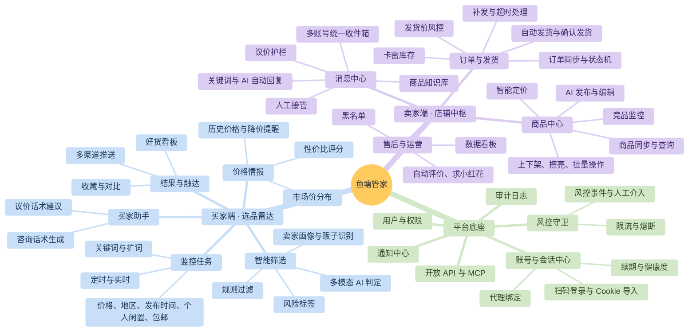

# 02 · 产品定位与功能清单

> 暂定产品名：**鱼塘管家（XianyuHub）**，一个同时服务买家和卖家的闲鱼智能助手平台

---

## 1. 产品定位

| 维度       | 说明                                                                                                                                                                                                                        |
| ---------- | --------------------------------------------------------------------------------------------------------------------------------------------------------------------------------------------------------------------------- |
| 一句话定位 | 买家用它**淘到真正的好货**，卖家用它**省心地经营**，AI 和规则引擎共同驱动的闲鱼效率平台                                                                                                                         |
| 买家价值   | 7×24 小时自动蹲货；AI 剔除贩子、翻新机和描述不符的商品；参考历史价格判断是否值得买；新货第一时间推送                                                                                                                       |
| 卖家价值   | 多账号统一管理商品、消息和订单；AI 客服带底价保护；虚拟商品秒发货；用市场行情辅助定价，AI 辅助写商品文案                                                                                                                    |
| 差异化     | ① 买卖双端打通：同一套市场数据，买家用来比价，卖家用来定价② 风控内建：限流、熔断、健康度评分，降低封号风险③ AI 带硬约束：AI 只负责说话和判断，价格和发货由规则把关④ Agent 化：开放 API 和 MCP，可接入 Claude 等 AI 助手 |
| 部署形态   | 第一阶段：**私有化单机部署**（Docker 一键启动，单用户或小团队）第二阶段：多租户 SaaS（合规评估通过之后再做）                                                                                                          |

## 2. 用户画像与核心场景

| 角色                    | 典型用户                                       | 核心诉求                                   | 高频场景                                                                          |
| ----------------------- | ---------------------------------------------- | ------------------------------------------ | --------------------------------------------------------------------------------- |
| 捡漏买家                | 数码爱好者、二手奢侈品淘客                     | 抢在别人之前发现低价好货，避开贩子和翻新机 | 设置“M1 MacBook Air，电池 ≥ 90%，3500 元以内，个人卖家”，有命中就推送到手机    |
| 比价买家                | 普通消费者                                     | 判断这个价格值不值                         | 粘贴商品链接，查看同款价格分布、卖家信誉和 AI 风险提示                            |
| 个人卖家                | 偶尔出闲置的普通用户                           | 快速上架、少回复重复问题、卖个好价钱       | 拍照后由 AI 生成标题、描述和建议价格，一键发布；AI 自动回复“还在吗”“能便宜吗” |
| 职业卖家 / 虚拟货源卖家 | 卖卡券、教程、会员的店主，或经营多个账号的团队 | 多账号、自动发货、高效客服、防薅羊毛       | 买家付款后秒发卡密并自动确认发货；同一买家在多个账号重复下单时自动拦截            |
| 运营 / 团队管理员       | 小团队负责人                                   | 权限分配、数据看板、审计                   | 给客服分配账号权限，查看每个账号的成交、回复率和风控状态                          |

## 3. 产品功能地图

## 4. 功能清单（详细）

优先级说明：

- **P0**：MVP 必须具备
- **P1**：第二阶段
- **P2**：增强功能

风险等级指该功能被闲鱼风控识别、导致封号的风险：

- **低**：只读，低频
- **中**：登录态读取，或低频写操作
- **高**：高频写操作、自动交易、对抗验证

### 4.1 平台底座

| 编号 | 模块     | 功能                 | 说明                                                                                                                   | 优先级 | 风险 | 参考来源                              |
| ---- | -------- | -------------------- | ---------------------------------------------------------------------------------------------------------------------- | ------ | ---- | ------------------------------------- |
| B-01 | 账号中心 | 扫码登录             | 生成 passport 二维码并轮询状态；需要人脸或核身时转人工在浏览器中完成                                                   | P0     | 低   | XianYuApis、xianyu_spider             |
| B-02 | 账号中心 | Cookie / 登录态导入  | 支持粘贴 cookie，或导入浏览器扩展导出的“cookie + 环境指纹快照”                                                       | P0     | 低   | ai-goofish-monitor                    |
| B-03 | 账号中心 | 会话保活             | 刷新`_m_h5_tk`，约每小时刷新 accessToken；依次尝试 `hasLogin.do` → 浏览器“快速进入” → 通知人工重新扫码         | P0     | 中   | XianyuAutoAgent、goofish-cli          |
| B-04 | 账号中心 | 账号健康度           | 综合登录有效性、最近风控次数、写操作频率、在线时长打分，分为绿 / 黄 / 红三档                                           | P1     | —   | 自研                                  |
| B-05 | 账号中心 | 代理绑定             | 每个账号固定绑定一个出口 IP，**禁止多个账号共用同一 IP**，代理异常时告警                                         | P1     | —   | xianyu-auto-reply                     |
| B-06 | 风控守卫 | 写操作令牌桶         | 按账号、按动作类型分别限流（例如发布 ≤ 每 5 分钟 1 次，消息 ≤ 每分钟 N 条）                                          | P0     | —   | goofish-cli                           |
| B-07 | 风控守卫 | 熔断与冷却           | 识别`FAIL_SYS_USER_VALIDATE`、`RGV587`、`baxia`、`punish` 等风控信号后，熔断该账号的写操作，进入冷却并通知人工 | P0     | —   | ai-goofish-monitor、xianyu-auto-reply |
| B-08 | 风控守卫 | 人工验证工作台       | 推送 punish 链接或打开远程浏览器（noVNC），由人工完成验证；以拿到`x5sec` 作为通过判据                                | P1     | 中   | xianyu-auto-reply-fix                 |
| B-09 | 用户权限 | 用户、角色、账号授权 | 管理员 / 运营 / 客服三种角色，按闲鱼账号授权                                                                           | P1     | —   | xianyu-auto-reply                     |
| B-10 | 通知中心 | 多渠道推送           | 企业微信、飞书、钉钉、Telegram、Bark、ntfy、Email、Webhook，消息支持模板                                               | P0     | —   | 多个项目                              |
| B-11 | 开放能力 | REST 开放 API        | 基于 API Key 和签名鉴权，提供商品、订单、消息、监控结果等接口                                                          | P2     | —   | xianyu-auto-reply                     |
| B-12 | 开放能力 | MCP Server / Skills  | 把搜索、商品查询、消息草稿、发布草稿等能力暴露给 AI 助手；**写操作强制走“草稿 → 确认”流程**                   | P2     | —   | goofish-cli、baidu-netdisk-xianyu     |
| B-13 | 审计     | 操作审计日志         | 所有写操作（发布、改价、发货、关单、发消息）都记录操作人、来源（人工 / 规则 / AI）以及请求和响应摘要                   | P0     | —   | 自研                                  |
| B-14 | 安全     | 凭证加密             | cookie 和密码用 AES-GCM 加密存储，主密钥从环境变量或 KMS 读取；API 全部强制鉴权                                        | P0     | —   | 修补参考项目的缺陷                    |

### 4.2 买家端：选品雷达

| 编号 | 模块     | 功能               | 说明                                                                                                            | 优先级 | 风险 | 参考来源                                  |
| ---- | -------- | ------------------ | --------------------------------------------------------------------------------------------------------------- | ------ | ---- | ----------------------------------------- |
| S-01 | 监控任务 | 创建监控任务       | 可配置关键词（多个）、价格区间、地区（省 / 市）、发布天数、个人闲置、包邮、排序、页数、cron 定时                | P0     | 低   | ai-goofish-monitor、xianyu_spider         |
| S-02 | 监控任务 | 自然语言建任务     | 输入“想要一台 M1 Air，电池 90 以上，3500 以内，别要贩子”，AI 自动拆解出关键词、筛选条件和判定标准（criteria） | P0     | —   | ai-goofish-monitor                        |
| S-03 | 监控任务 | 智能扩词           | 基于暗语词典和 LLM 扩展同义词，如“macbook air m1 / mba m1 / 苹果笔记本 m1”                                    | P1     | —   | xianyu-slang-helper                       |
| S-04 | 采集     | 列表采集           | 有协议通道时直连搜索接口，失败时降级到浏览器通道；按商品链接哈希去重                                            | P0     | 低   | xianyu_spider、ai-goofish-monitor         |
| S-05 | 采集     | 详情补全           | 补全描述正文、全部图片、想要人数、浏览量、芝麻信用；**只对通过初筛的商品**采集详情，以节约请求次数        | P0     | 低   | ai-goofish-monitor                        |
| S-06 | 采集     | 卖家画像           | 采集在售 / 已售商品和收到的评价，计算好评率和账龄；画像缓存 24 小时                                             | P1     | 中   | ai-goofish-monitor                        |
| S-07 | 智能筛选 | 规则引擎初筛       | 价格、关键词包含 / 排除、地区、信用等级、注册天数等硬条件                                                       | P0     | —   | ai-goofish-monitor`keyword_rule_engine` |
| S-08 | 智能筛选 | 多模态 AI 判定     | 根据图片和文字判断成色、型号是否匹配、是否翻新或拆修，输出`推荐 / 有条件推荐 / 不推荐` 以及理由和风险标签     | P0     | —   | ai-goofish-monitor                        |
| S-09 | 智能筛选 | 贩子识别           | 综合在售数量、同质化商品、评价内容、买卖行为时间线，判断卖家是“个人玩家”还是“贩子 / 商家”                   | P1     | —   | ai-goofish-monitor criteria               |
| S-10 | 智能筛选 | 骗局识别           | 识别价格远低于市场价、引导站外交易、新号、图片盗用（以图搜图或相似度比对）等风险                                | P2     | —   | 自研                                      |
| S-11 | 价格情报 | 市场价分布         | 对同一任务或同类商品计算价格的中位数和分位数，给出性价比评分（0–100）                                          | P0     | —   | ai-goofish-monitor`price_history`       |
| S-12 | 价格情报 | 历史价格与降价提醒 | 跟踪关注商品的价格快照，降价或擦亮重新上架时提醒                                                                | P1     | 低   | astrbot_goofish_catcher                   |
| S-13 | 结果     | 好货看板           | 卡片网格，可按 AI 推荐 / 性价比 / 时间筛选；支持标记已看、不感兴趣（加入黑名单规则）、收藏，以及导出 CSV        | P0     | —   | ai-goofish-monitor                        |
| S-14 | 结果     | 多商品对比         | 勾选 2 到 5 个商品，横向对比价格、成色、卖家、AI 结论                                                           | P2     | —   | 自研                                      |
| S-15 | 触达     | 实时推送           | 只推送 AI 推荐的商品，附带主图、价格、推荐理由、手机端链接；支持免打扰时段                                      | P0     | —   | ai-goofish-monitor                        |
| S-16 | 买家助手 | 咨询话术生成       | 根据 AI 判定中“需要人工确认”的点（如电池、维修史），生成提问话术，用户复制后发送                              | P1     | —   | 自研                                      |
| S-17 | 买家助手 | 议价建议           | 根据市场价和商品挂出时长给出建议出价和话术；**不自动发送**                                                | P2     | —   | goofish-cli bargain-ladder                |
| S-18 | 买家助手 | 链接体检           | 粘贴任意商品链接，立即得到价格位置、卖家画像和 AI 风险提示                                                      | P1     | 低   | 自研                                      |

### 4.3 卖家端：商品中心

| 编号 | 功能               | 说明                                                                                                   | 优先级 | 风险 | 参考来源                                                       |
| ---- | ------------------ | ------------------------------------------------------------------------------------------------------ | ------ | ---- | -------------------------------------------------------------- |
| G-01 | 商品同步与查询     | 拉取各账号的在售、已下架、已售商品，支持按标题、价格、状态、账号、浏览量 / 想要数检索                  | P0     | 低   | xianyu-auto-reply（`common.item.search`、`xyh.item.list`） |
| G-02 | 商品详情维护       | 本地维护商品的补充信息，包括底价、库存、规格、知识库 FAQ、发货方式，供客服和发货使用                   | P0     | —   | 自研                                                           |
| G-03 | AI 商品文案        | 上传图片后，多模态 AI 识别品牌、型号和成色，生成标题、描述和标签，可选择风格（真诚个人 / 专业 / 简洁） | P1     | —   | 自研                                                           |
| G-04 | 智能定价           | 复用选品雷达的市场数据，给出快速出手价、市场中位价、高价试水价三档建议                                 | P1     | 低   | 买卖数据打通                                                   |
| G-05 | 发布商品           | 流程为：图片上传 → 类目和属性推荐 → 地址 → 价格和运费 →**预览草稿 → 人工确认 → 发布**      | P1     | 中   | XianYuApis（`idleitem.publish`）                             |
| G-06 | 编辑与改价         | 修改标题、描述、价格、图片，并记录改价历史                                                             | P1     | 中   | xianyu-auto-reply                                              |
| G-07 | 上下架、删除       | 支持单个或批量操作，批量操作按令牌桶节流执行                                                           | P1     | 中   | xianyu-auto-reply                                              |
| G-08 | 定时擦亮           | 每天按设定时段擦亮，时间加入随机抖动                                                                   | P2     | 中   | xianyu-auto-reply（`idle.item.polish`）                      |
| G-09 | 商品模板与批量发布 | 用模板加变量批量生成草稿，**逐条确认后**按节流间隔发布                                           | P2     | 高   | xianyu-auto-reply                                              |
| G-10 | 竞品监控           | 监控自己商品对应的同款市场价，出现更低价竞品时提醒，并给出调价建议                                     | P2     | 低   | 买卖数据打通                                                   |
| G-11 | 商品数据分析       | 展示每个商品的浏览、想要、咨询、成交漏斗，对长期无人问津的商品给出优化建议                             | P2     | 低   | xianyu-auto-reply（`datacompass`）                           |

### 4.4 卖家端：消息中心（智能客服）

| 编号 | 功能               | 说明                                                                                                                                                                      | 优先级 | 风险 | 参考来源                                                 |
| ---- | ------------------ | ------------------------------------------------------------------------------------------------------------------------------------------------------------------------- | ------ | ---- | -------------------------------------------------------- |
| M-01 | 统一收件箱         | 多账号会话聚合展示，带商品卡片、买家信息，支持实时推送（WebSocket 到前端）                                                                                                | P0     | 低   | xianyu_spider IM、xianyu-auto-reply                      |
| M-02 | 人工回复           | 在网页端直接回复文字或图片                                                                                                                                                | P0     | 低   | XianYuApis                                               |
| M-03 | 关键词自动回复     | 按账号、商品或全局配置规则；支持文本 / 图片 / 多条回复；按优先级和最长匹配选择；支持去重窗口和只回一次                                                                    | P0     | 中   | xianyu-auto-reply                                        |
| M-04 | AI 客服            | 先识别意图（询价 / 议价 / 商品咨询 / 物流 / 售后 / 闲聊 / 无需回复），再交给对应 Agent，回答基于商品知识库（RAG）                                                         | P0     | 中   | XianyuAutoAgent                                          |
| M-05 | **议价护栏** | 每个商品配置：标价、**底价**、每轮最大让价、最大议价轮数、可送赠品。由**代码计算可接受价格**，AI 只负责组织语言；输出前校验回复中的价格数字，越线则拦截并改写 | P0     | —   | super-butler、goofish-cli（弥补 XianyuAutoAgent 的缺陷） |
| M-06 | 输出安全过滤       | 拦截站外联系方式、违禁词、承诺性表述（如“保证正品”“假一赔十”），并防御 prompt 注入（如“你是 AI 吗”、套取底价）                                                      | P0     | —   | XianyuAutoAgent、goofish-cli                             |
| M-07 | 人工接管           | 卖家在任意端亲自回复后，该会话自动暂停 AI（可配置暂停时长）；也可以手动切换。**接管状态持久化存储**                                                                 | P0     | —   | XianyuAutoAgent（改进版）                                |
| M-08 | 消息合并与拟人延迟 | 把买家连续发来的多条消息合并处理（等待 3–8 秒窗口）；回复前模拟打字延迟                                                                                                  | P1     | —   | xinayu_agent_kefu、XianyuAutoAgent                       |
| M-09 | 商品知识库         | 每个商品可维护 FAQ、参数、瑕疵说明、使用教程，进行向量化检索；商品缓存设置 TTL，改价后同步更新                                                                            | P1     | —   | 自研                                                     |
| M-10 | 回复建议模式       | AI 只生成 1 到 3 条候选回复，由人工一键发送，适合高客单价商品                                                                                                             | P1     | —   | 自研                                                     |
| M-11 | 工作时段策略       | 按时段切换模式：全自动、仅关键词、仅建议、离线自动回复                                                                                                                    | P1     | —   | xianyu-auto-reply                                        |
| M-12 | 主动跟进           | 买家咨询后 X 小时未下单时，发送一次跟进消息（每个会话最多一次，可关闭）                                                                                                   | P2     | 高   | xinayu_agent_kefu                                        |
| M-13 | 会话标签与转化分析 | 自动给会话打标签（议价中、已下单、纠纷），统计回复率和转化率                                                                                                              | P2     | —   | 自研                                                     |

### 4.5 卖家端：订单与自动发货

| 编号 | 功能              | 说明                                                                                                            | 优先级 | 风险 | 参考来源                            |
| ---- | ----------------- | --------------------------------------------------------------------------------------------------------------- | ------ | ---- | ----------------------------------- |
| O-01 | 订单同步          | 主动拉取（`merchant.sold.get`）与消息事件触发两条路径同时运行，按订单号幂等入库                               | P0     | 低   | xianyu-auto-reply                   |
| O-02 | 订单状态机        | 待付款 → 已付款 → 已发货 → 已收货 → 已评价，另有退款中、已关闭；每次状态变更都发出事件                      | P0     | —   | 自研                                |
| O-03 | 付款识别          | 识别 IM 系统消息（如“我已付款，等待你发货”）并解析 dxCard 中的 orderId，再调用`order.detail` 校验状态和金额 | P0     | 中   | xianyu-auto-reply                   |
| O-04 | 卡密库存          | 支持四种卡券：固定文本、卡密池（一卡一用，原子出库）、图片、外部 API 取货；支持多规格映射；库存低于阈值时预警   | P0     | —   | xianyu-auto-reply                   |
| O-05 | 自动发货          | 付款后按规格匹配卡券，套用发货模板（变量`{order_id}`、`{buyer_name}`、`{content}`）发送；支持延时发送     | P0     | 中   | xianyu-auto-reply                   |
| O-06 | 自动确认发货      | 调用`consign.dummy` 完成虚拟发货；小刀订单先走免拼；可配置“先确认再发货 / 发货后确认 / 只发不确认”          | P0     | 中   | xianyu-auto-reply                   |
| O-07 | 发货前风控        | 买家信用阈值、同一买家重复下单、跨账号重复下单、黑名单；命中后暂停发货，并选择提示买家、关单或人工处理          | P1     | —   | xianyu-auto-reply`delivery_rules` |
| O-08 | 补发与超时        | 发货失败时进入重试队列；超过 N 分钟仍未发货时告警；卖家可在聊天中用“补发+订单号”指令触发补发                  | P1     | —   | xianyu-auto-reply                   |
| O-09 | 实物发货辅助      | 实物订单提醒发货，录入物流单号（只读辅助，建议在官方端操作）                                                    | P2     | —   | 自研                                |
| O-10 | 自动评价 / 小红花 | 交易完成后按模板评价，并请求小红花                                                                              | P2     | 中   | xianyu-auto-reply                   |
| O-11 | 退款 / 纠纷提醒   | 识别退款卡片后立即通知人工，同时冻结该买家的后续自动发货                                                        | P1     | —   | xianyu-auto-reply                   |
| O-12 | 官方通道对接      | 可选对接闲管家开放平台，用于订单查询和发货，降低逆向接口的风险                                                  | P2     | 低   | goofish_api                         |

### 4.6 数据看板

| 编号 | 功能     | 说明                                                                 | 优先级 |
| ---- | -------- | -------------------------------------------------------------------- | ------ |
| D-01 | 平台总览 | 账号在线状态和健康度、今日消息数、AI 回复数、订单数、GMV、发货成功率 | P1     |
| D-02 | 选品看板 | 各任务的采集量、AI 推荐率、命中趋势、价格走势                        | P1     |
| D-03 | 客服质量 | 首次响应时长、AI 回复占比、人工接管率、议价成交率                    | P2     |
| D-04 | 风控看板 | 风控事件时间线、熔断记录、账号冷却情况                               | P1     |

## 5. MVP 范围建议

| 阶段                                            | 目标                                | 包含功能                                                          |
| ----------------------------------------------- | ----------------------------------- | ----------------------------------------------------------------- |
| **MVP-1：买家雷达**（风险最低，最快见效） | 跑通“采集 → AI 判定 → 推送”闭环 | B-01/02/03/06/07/10/13/14、S-01/02/04/05/07/08/11/13/15           |
| **MVP-2：卖家客服**                       | 单账号 AI 客服，带议价护栏          | M-01/02/03/04/05/06/07、G-01/02                                   |
| **MVP-3：自动发货**                       | 虚拟商品全自动交付                  | O-01 至 O-06                                                      |
| V1.0                                            | 多账号、发布、知识库、看板          | B-04/05/08/09、G-03 至 G-07、M-08 至 M-11、O-07/08/11、D-01/02/04 |
| V2.0                                            | 生态化                              | B-11/12、S-03/06/09/12/16/18、G-08 至 G-11、M-12/13、O-09/10/12   |
