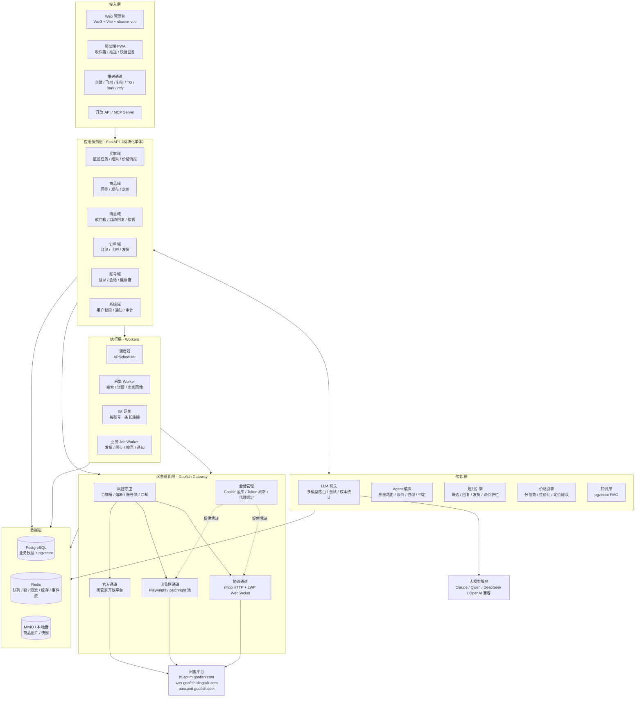
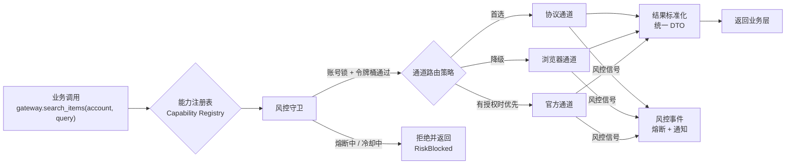
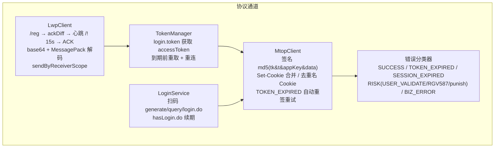
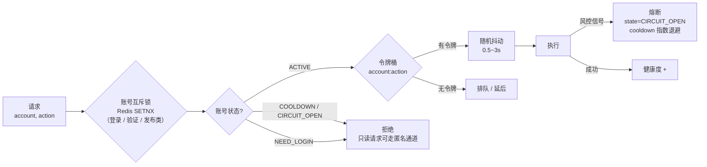
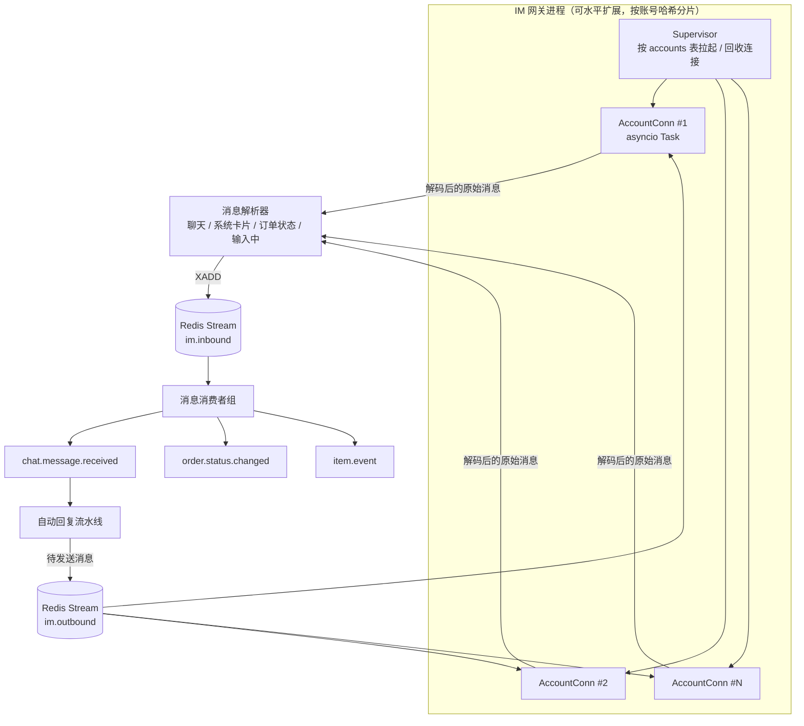
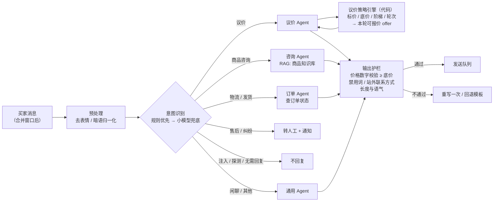
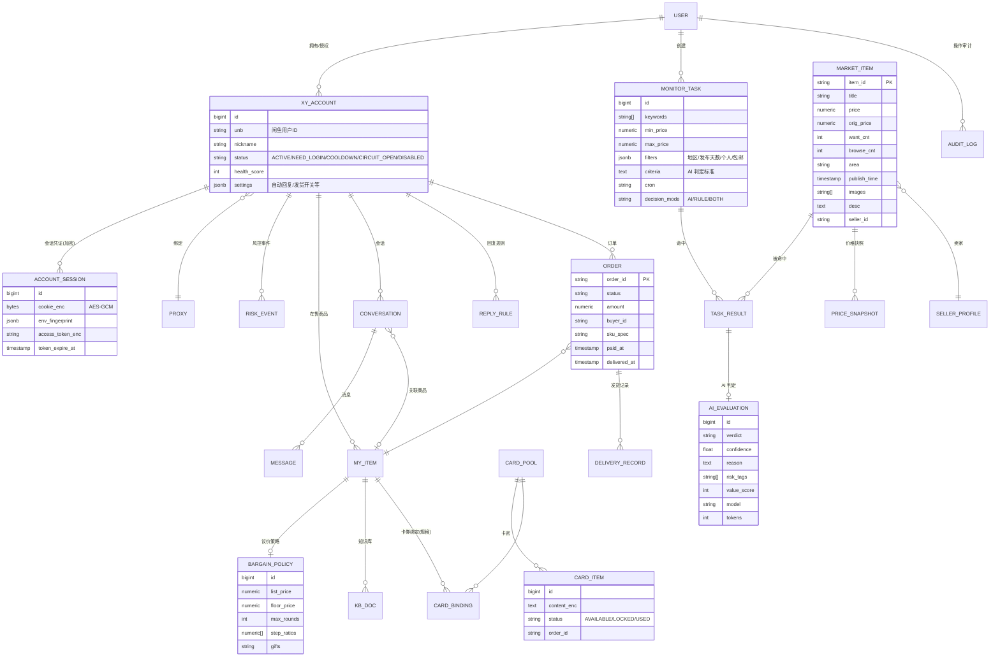
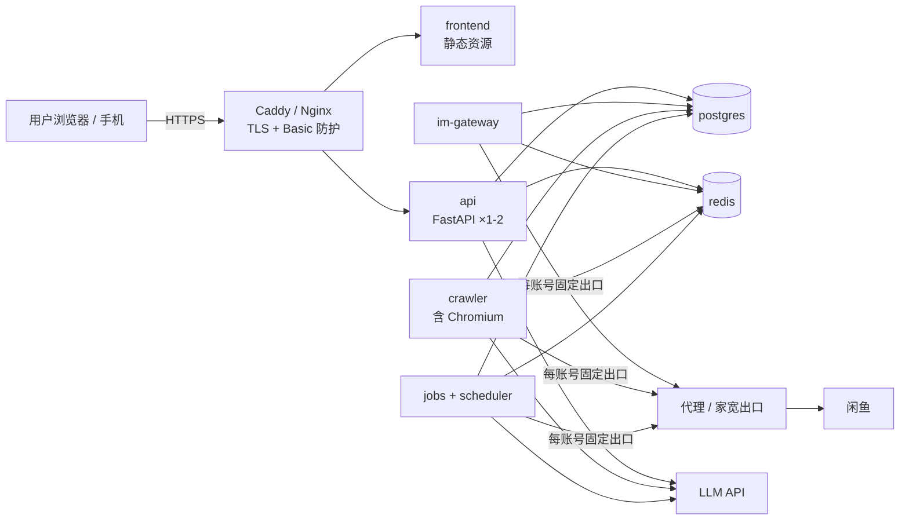

# 03 · 系统架构设计

> 设计原则：
> 1. **适配层隔离**：把闲鱼的易变部分（接口、文案、风控）收拢在一层里
> 2. **风控一等公民**：限流、熔断、加锁在调用链上统一处理，业务代码无需关心
> 3. **AI 有护栏**：AI 产出建议，规则做最终裁决
> 4. **事件驱动**：消息、订单、商品的状态变化都以事件的形式流转
> 5. **私有化优先**：单机 Docker 就能跑起来，后续可平滑拆分

---

## 1. 总体架构图



### 分层职责

| 层 | 职责 | 关键点 |
|---|---|---|
| 接入层 | 人机交互、外部系统接入 | 所有 API 都必须鉴权（JWT 或 API Key），不允许存在匿名接口 |
| 应用服务层 | 业务编排，按领域划分模块 | 初期采用**模块化单体**，领域之间只通过 Service 接口和事件通信，日后可拆分成微服务 |
| 智能层 | AI 与规则 | 规则引擎拥有最终否决权，AI 的输出必须结构化（JSON Schema 校验） |
| 执行层 | 长连接、定时任务、异步任务 | 每个 Worker 都可以独立扩容；IM 网关按账号分片 |
| 适配层 | **所有与闲鱼交互的唯一出入口** | 业务代码只调用能力接口（如 `search_items`、`send_message`），不关心底层走哪个通道 |
| 数据层 | 持久化与中间件 | 单用户场景可以退化为 SQLite + 内存队列 |

---

## 2. 闲鱼适配层（核心）

### 2.1 能力抽象与多通道路由



**能力清单与通道矩阵**（✅ 支持，⚪ 可降级，— 不支持）：

| 能力 | 协议通道 | 浏览器通道 | 官方通道 | 是否需要登录 | 默认限流（每账号） |
|---|---|---|---|---|---|
| `search_items` 搜索 | ✅ `idlemtopsearch.pc.search` | ⚪ 拦截 XHR 响应 | — | 否（匿名即可） | 6 次/分钟 |
| `get_item_detail` 商品详情 | ✅ `idle.pc.detail` | ⚪ | — | 否 | 10 次/分钟 |
| `get_seller_profile` 卖家画像 | ✅ `user.page.head` / `xyh.item.list` / `trade.rate.list` | ⚪ | — | 建议登录 | 3 次/分钟 |
| `list_my_items` 我的商品 | ✅ `common.item.search` | ⚪ | ✅ | 是 | 2 次/分钟 |
| `publish_item` 发布 | ✅ `idleitem.publish` + 类目推荐 + 上传 | ⚪ | ✅ | 是 | 1 次/5 分钟 |
| `edit_item` / `offline_item` / `polish_item` | ✅ | ⚪ | 部分 | 是 | 1 次/分钟 |
| `upload_media` 上传图片 | ✅ `stream-upload.goofish.com` | — | ✅ | 是 | 10 次/分钟 |
| `im_connect` / `send_message` 消息 | ✅ LWP WebSocket | — | — | 是 | 20 条/分钟，每会话 ≥ 2 秒间隔 |
| `list_orders` / `get_order` 订单 | ✅ `merchant.sold.get` / `order.detail` | — | ✅ | 是 | 6 次/分钟 |
| `consign_virtual` 虚拟发货 | ✅ `logistic.consign.dummy` | — | ✅ | 是 | 10 次/分钟 |
| `rate_order` 评价 | ✅ `idle.rate.create` | — | — | 是 | 2 次/分钟 |

> 限流数值是建议的初始值，需要根据实际风控反馈调整，并保存在配置中心中供动态修改。

### 2.2 协议通道内部结构



**错误分类与处理策略**

| 分类 | 典型返回码 / 信号 | 处理 |
|---|---|---|
| TOKEN_EXPIRED | `FAIL_SYS_TOKEN_EXOIRED` / `TOKEN_EMPTY` | 合并 Set-Cookie 中的新 `_m_h5_tk`，重新签名，最多重试 2 次 |
| SESSION_EXPIRED | `FAIL_SYS_SESSION_EXPIRED`、被重定向到 passport | 账号状态置为 `NEED_LOGIN`，依次尝试 `hasLogin.do` 续期 → 浏览器续期 → 通知人工扫码 |
| RISK | `FAIL_SYS_USER_VALIDATE`、`RGV587_ERROR`、`baxia-dialog`、`punish?x5secdata`、`_____tmd_____` | **立即熔断该账号的写操作**，冷却 30 分钟起（指数退避），记录风控事件，推送 punish 链接让人工处理 |
| RATE | “挤爆”、频繁类提示 | 降低该账号的令牌桶速率，并退避 |
| BIZ_ERROR | 业务失败（商品不存在、状态不允许等） | 直接返回给业务层 |

### 2.3 风控守卫



**关键规则**

- **一个账号绑定一个固定出口 IP**（家宽或住宅代理优先），不随请求轮换 IP，避免“异地登录”触发风控。
- 读和写分开处理：匿名搜索可以走独立的匿名会话池，**不消耗卖家账号的信誉**。
- 写操作全部入队，由 Worker 节流执行；批量操作必须拆成单条，并设置间隔。
- 不内置自动破解滑块；风控信号一律熔断，交给人工处理，人工通过后再恢复。
- 避免频繁重启进程，IM 网关在进程级别复用 accessToken，并缓存在 Redis 中，TTL 55 分钟。

---

## 3. IM 网关设计（卖家消息中枢）



- **连接生命周期**：取 token → `/reg` → `ackDiff` → 心跳 → 约 1 小时刷新 token 并重连；断线后指数退避重连（1s、2s、4s，最长 60s）。
- **出站消息统一走 `im.outbound`**：经过限流、拟人延迟、安全过滤后才真正发送，同时写入审计日志。
- **卖家自己发出的消息**也会同步回来（`senderUserId == 自己`），用来触发人工接管。
- 与网页版 IM 同时在线可能会互相踢掉 token，要在界面上提示用户。

---

## 4. 智能层设计

### 4.1 LLM 网关

| 功能 | 说明 |
|---|---|
| 多模型路由 | 按任务选择模型：**多模态判定**用视觉模型；**意图分类**用小模型（低延迟、低成本）；**客服回复**用中等模型；**文案生成**用强模型 |
| 统一接口 | 同时适配 OpenAI 兼容协议、Anthropic Messages API、DashScope；输出强制为 JSON Schema 结构 |
| 成本控制 | 图片先压缩到 1024px 并限制张数（最多 4 张）；结果缓存（按商品 ID + 内容哈希）；统计 token 并设置预算上限 |
| 降级 | 主模型失败时切换到备模型；全部失败时回落到“仅规则”模式 |
| 隐私 | 可配置脱敏规则（手机号、地址）；支持只用本地模型（Ollama / vLLM）的离线模式 |

### 4.2 客服 Agent 编排（带护栏）



**议价策略引擎**（代码硬约束，不交给 LLM 决定）

```
输入：标价 P，底价 F，当前轮次 n，最大轮次 N，买家出价 B，商品热度 H（想要数 / 浏览量）
1. 如果 B ≥ P × 0.98             → 接受，引导买家拍下
2. 如果 n ≥ N                    → 给出最终价 max(F, 当前报价)，不再继续让价
3. 本轮让价 step = (P − F) × r_n  （r 为递减序列，例如 40%、30%、20%、10%）
   热度高时 step 打折（让得更少）
4. offer = max(F, 上轮报价 − step)；如果 B ≥ offer → 按 B 成交
5. LLM 只拿到 {offer, 是否最终价, 可送赠品} 用于组织语言
6. 输出后用正则抽取回复中的所有金额，任何 < F 的金额都会被拦截
```

### 4.3 选品判定 Agent

- **两段式判定**，用来节约成本：
  - 第一段只用列表字段，经过规则和小模型粗筛（文本）。
  - 第二段对候选商品补全详情和卖家画像，再做多模态精判。
- 判定标准（criteria）采用“**基础模板 + 品类标准 + 用户偏好**”三层组合，用户可以在线编辑，也可以由 AI 生成。
- 输出结构：

```json
{
  "verdict": "RECOMMEND | CONDITIONAL | REJECT",
  "confidence": 0.0,
  "reason": "...",
  "risk_tags": ["疑似贩子", "图片与描述不符"],
  "need_confirm": ["电池健康", "是否拆修"],
  "seller_type": "PERSONAL | DEALER | UNKNOWN",
  "value_score": 0
}
```

---

## 5. 数据模型（核心 ER）



---

## 6. 技术选型

| 领域 | 选型 | 理由 |
|---|---|---|
| 后端语言 / 框架 | **Python 3.12 + FastAPI + Pydantic v2** | 参考项目都是 Python，协议实现可直接复刻；asyncio 适合大量长连接 |
| ORM / 迁移 | SQLAlchemy 2.0 async + Alembic | 成熟，便于版本化管理数据库结构 |
| 数据库 | **PostgreSQL 16 + pgvector**（单机可用 SQLite） | 同时满足 JSONB、全文检索、向量检索 |
| 缓存 / 队列 / 事件 | **Redis 7**（Streams、分布式锁、令牌桶 Lua 脚本） | 一个组件覆盖多种需求，降低运维成本 |
| 任务调度 | APScheduler（定时）+ arq 或 Redis Streams 消费组（异步任务） | 轻量；不引入 Celery 也够用 |
| 浏览器自动化 | Playwright（可替换为 patchright）+ 浏览器上下文池 | 用于登录、核身、浏览器降级通道 |
| HTTP | httpx（HTTP/2、代理、连接池） | 异步，性能好 |
| LLM | LiteLLM 风格的自研网关；默认 Claude（多模态、文案）+ Qwen / DeepSeek（低成本分类） | 多供应商、可降级 |
| 前端 | **Vue 3 + Vite + TypeScript + shadcn-vue + Tailwind + ECharts** | 可参考 ai-goofish-monitor 的界面；组件库成熟 |
| 实时推送 | WebSocket（FastAPI）/ SSE | 收件箱、日志、监控结果实时刷新 |
| 部署 | Docker Compose（单机）→ K8s（SaaS 阶段） | 一键私有化部署 |
| 可观测性 | Loguru 结构化日志 + Prometheus 指标 + Grafana；Sentry | 风控事件和发货失败必须可追踪 |
| 安全 | JWT + RBAC；AES-GCM 加密凭证；主密钥来自环境变量或 KMS | 弥补参考项目的安全缺陷 |

---

## 7. 工程目录结构（建议）

```
xianyuhub/
├── backend/
│   ├── app/
│   │   ├── api/                 # FastAPI 路由（v1），全部挂鉴权依赖
│   │   ├── core/                # 配置、安全、加密、日志、事件总线
│   │   ├── domains/
│   │   │   ├── account/         # 账号、会话、健康度
│   │   │   ├── buyer/           # 监控任务、结果、价格情报
│   │   │   ├── goods/           # 我的商品、发布、定价
│   │   │   ├── message/         # 会话、消息、回复规则、接管
│   │   │   ├── order/           # 订单、卡密、发货、发货规则
│   │   │   └── system/          # 用户、权限、通知、审计
│   │   ├── intelligence/
│   │   │   ├── llm_gateway/     # 多模型适配、缓存、计费
│   │   │   ├── agents/          # intent / bargain / qa / judge / copywriter
│   │   │   ├── guardrails/      # 价格校验、禁用词、注入防御
│   │   │   ├── rules/           # 规则引擎
│   │   │   └── pricing/         # 价格引擎
│   │   └── goofish/             # ★ 闲鱼适配层（唯一出入口）
│   │       ├── capabilities.py  # 能力接口定义
│   │       ├── guard/           # 令牌桶、熔断、账号锁、冷却
│   │       ├── protocol/        # mtop.py, sign.py, lwp.py, msgpack.py, login.py
│   │       ├── browser/         # 上下文池、XHR 拦截、反检测
│   │       ├── official/        # 闲管家开放平台
│   │       └── parsers/         # 各接口响应 → 统一 DTO
│   ├── workers/
│   │   ├── im_gateway.py        # IM 长连接进程
│   │   ├── crawler.py           # 采集 Worker
│   │   ├── jobs.py              # 业务异步任务
│   │   └── scheduler.py         # 定时任务
│   ├── prompts/                 # 判定标准、客服、文案 Prompt 模板
│   ├── migrations/
│   └── tests/                   # 用录制的响应样本做协议解析回归测试
├── frontend/                    # Vue3 管理台 + PWA
├── extension/                   # 浏览器扩展：导出登录态
├── deploy/
│   ├── docker-compose.yml
│   └── .env.example
└── docs/
```

## 8. 部署拓扑（单机私有化）



- 最低配置：2 核 4GB 内存（跑浏览器通道建议 4 核 8GB）。
- **强烈建议部署在家庭网络、NAS 或使用住宅代理**，机房 IP 更容易被风控。
- 默认只监听内网地址；需要公网访问时，必须启用 HTTPS 和强密码，最好再加 2FA。
