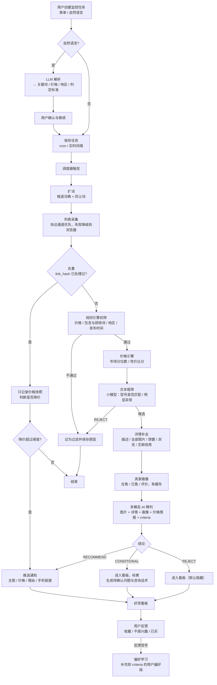
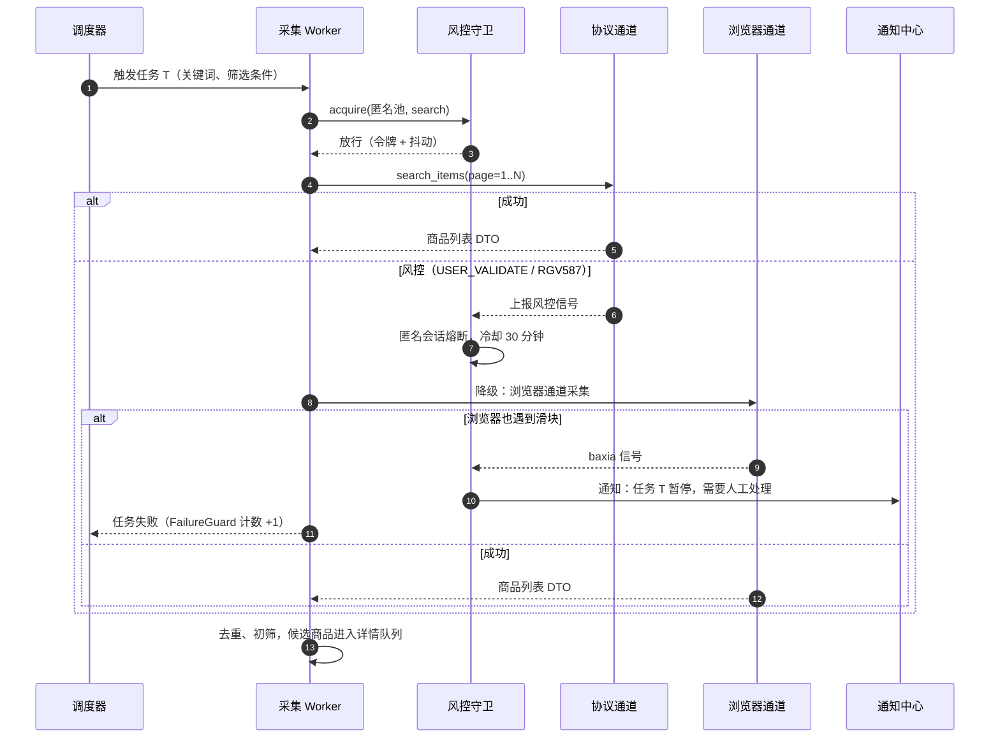
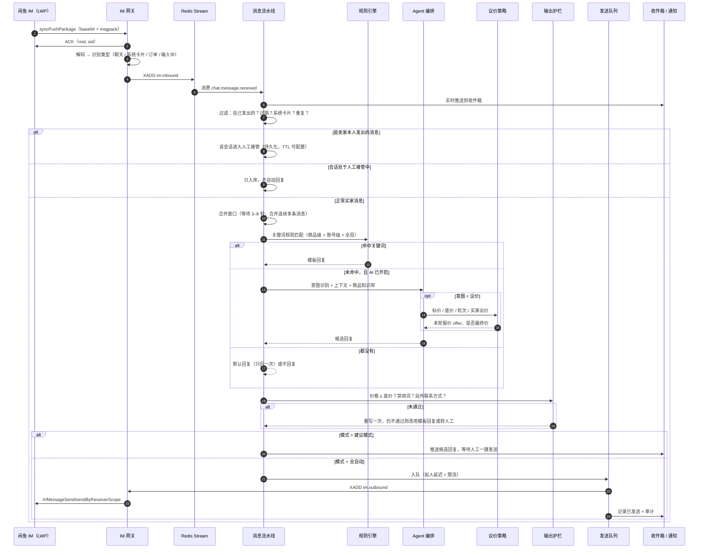
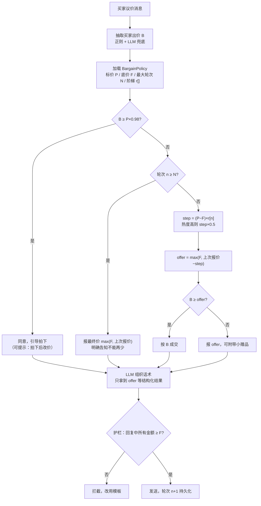
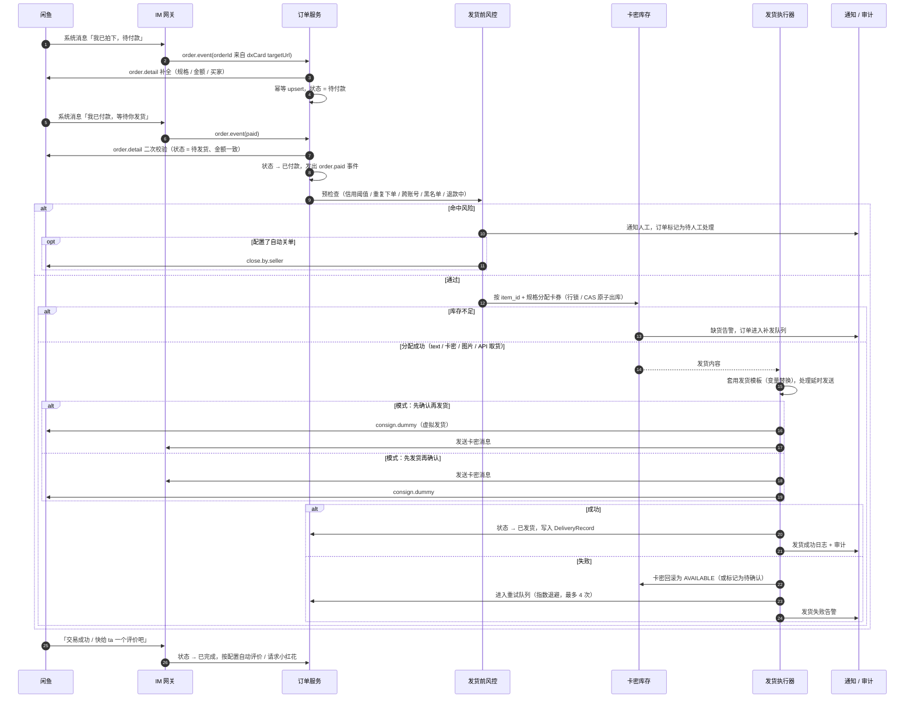
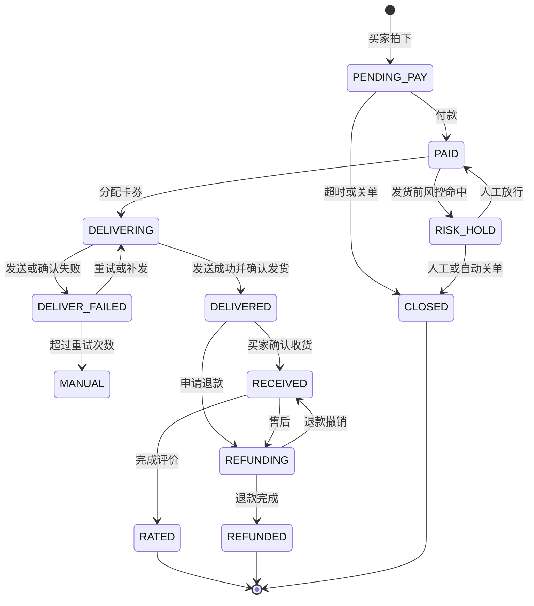
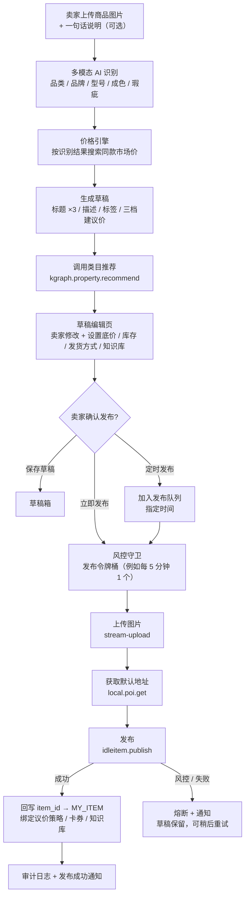
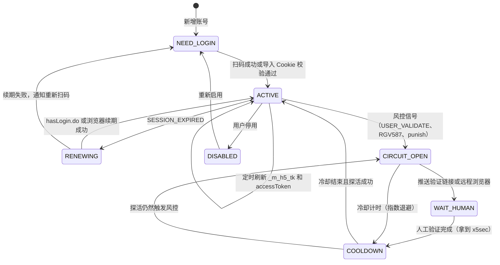
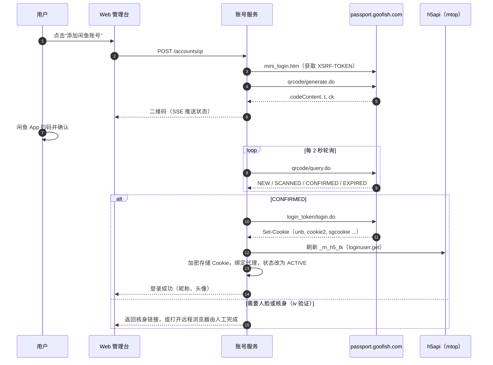
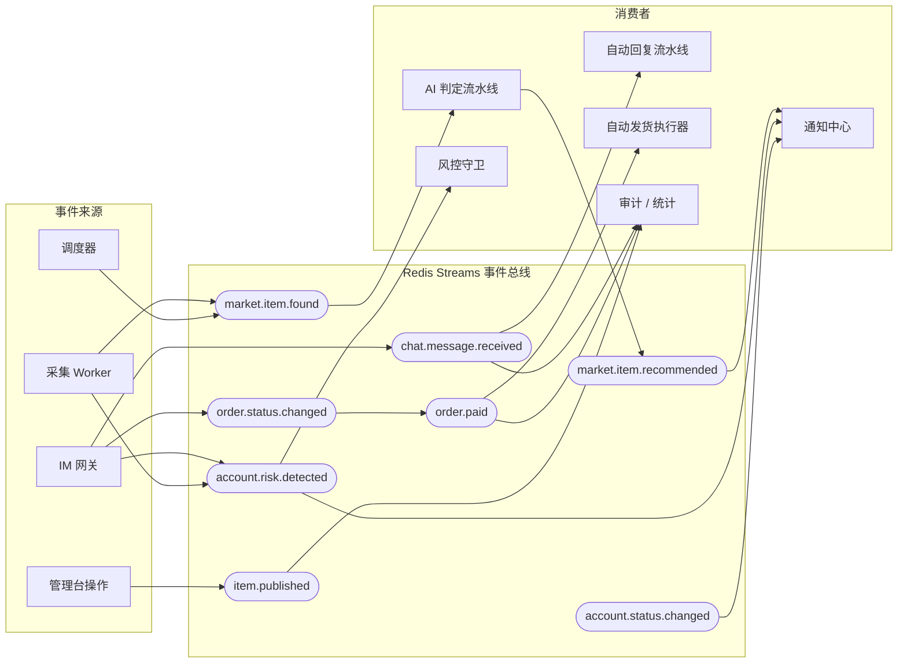

# 04 · 核心业务流程图

本文的流程图都用 Mermaid 编写。可以在 VSCode 中安装 “Markdown Preview Mermaid Support” 插件后预览，GitHub 和 Typora 也能直接渲染。

---

## 1. 买家：选品雷达端到端流程

### 采集阶段的风控与降级

---

## 2. 卖家：消息处理与自动回复流程

### 议价决策流程（代码层）

---

## 3. 卖家：订单与自动发货流程

### 订单状态机

---

## 4. 卖家：AI 辅助发布商品流程

---

## 5. 账号登录、续期与风控熔断

### 5.1 账号状态机

### 5.2 扫码登录时序

---

## 6. 事件流总览（领域事件）

