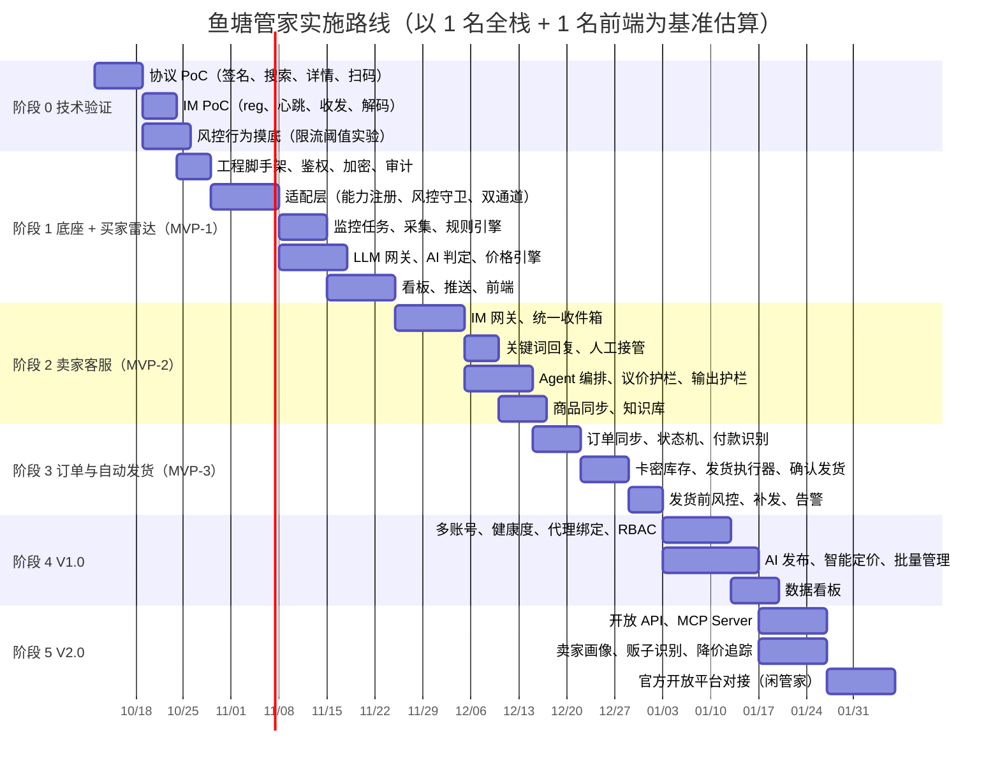

# 05 · 风险合规与实施路线

---

## 1. 风险矩阵

| # | 风险 | 可能性 | 影响 | 说明 | 应对措施 |
|---|---|---|---|---|---|
| R1 | **平台条款 / 账号封禁** | 高 | 高 | 自动化访问、协议逆向、批量写操作、多账号都违反闲鱼和阿里的用户协议；社区里 `RGV587 / USER_VALIDATE` 是最高频的问题 | 读写分离，匿名池只做读取；写操作用令牌桶限速；一个账号对应一个固定 IP；遇到风控即熔断；**不内置自动过滑块**；默认开启“建议模式”，即人工确认后才发送 |
| R2 | **法律合规** | 中 | 高 | 绕过技术保护措施、大规模抓取个人信息（卖家主页、评价）可能涉及《反不正当竞争法》《个人信息保护法》《数据安全法》；把服务商业化运营会进一步放大风险 | 限定为**用户本人账号、本人数据的效率工具**；卖家画像只做短期缓存，不对外提供；不做数据转售；商业化之前先做法务评估；能用闲管家开放平台的地方优先走官方接口 |
| R3 | **开源许可证** | 中 | 中 | xianyu-auto-reply 是 AGPL 并额外声明禁止商用；XianyuAutoAgent 是 GPL-3.0；XianYuApis 和 xianyu_spider 没有 LICENSE 文件；ai-goofish-monitor 是 MIT | **采用净室实现**：只参考协议事实和设计思路，不复制 GPL/AGPL 代码和没有 LICENSE 的代码；MIT 代码复用时保留版权声明；在 THIRD_PARTY_NOTICES 中记录依赖来源 |
| R4 | **协议变更** | 高 | 中 | 接口路径、签名参数、IM 消息结构、系统消息文案都可能变化，导致付款识别或订单号提取失效 | 闲鱼相关代码全部收拢在适配层；解析器用**录制的响应样本做回归测试**；每天跑一次探活巡检，发现异常立即告警；付款识别做两条路径：消息文案 + 订单接口轮询 |
| R5 | **凭证泄露** | 中 | 高 | 参考项目普遍存在接口无鉴权、cookie 明文保存的问题；cookie 一旦泄露就等于账号失控 | 所有接口强制鉴权；cookie 和密码用 AES-GCM 加密；默认只监听内网；日志中的敏感字段打码；**不把 cookie 发送给任何第三方**（远程 token 或远程打码服务） |
| R6 | **AI 误报价 / 胡乱承诺** | 中 | 高 | LLM 报出低于底价的价格，或做出“保证正品”这类承诺，可能造成经济损失或纠纷 | 议价完全由代码计算；输出护栏校验回复中的金额和承诺类措辞；高客单价商品默认使用建议模式；所有 AI 回复都可追溯 |
| R7 | **自动发货被薅** | 中 | 中 | 虚拟商品被恶意重复下单或退款后仍拿到卡密 | 发货前风控（信用阈值、重复下单、跨账号、黑名单）；退款事件触发冻结；卡密原子出库并记录归属；库存预警 |
| R8 | **站外引流 / 违规内容** | 中 | 中 | 回复中出现微信、QQ 等联系方式会被平台判定违规 | 禁用词库与站外联系方式检测；可以从 goofish-cli 的 forbidden-words 等资料补充词库 |
| R9 | **LLM 成本** | 中 | 低 | 多模态判定按图片计费，监控任务一多成本就会失控 | 两段式判定（先用文本粗筛）；图片压缩并限制张数；结果缓存；按任务设置预算上限；分类类任务用小模型 |
| R10 | **IP / 环境风控** | 高 | 中 | 机房和 Docker IP 更容易被风控；过了滑块也可能因为环境原因不被认可 | 推荐部署在家宽或 NAS 上；使用住宅代理；浏览器通道还原真实指纹快照 |

> **定位建议**：把产品定位为“**个人和小卖家的私有化效率工具**”，而不是公开的 SaaS 抓取服务。所有自动写操作都提供开关，并默认采用保守配置。

---

## 2. 实施路线图

> 工期是粗略估算，阶段 0 的技术验证结果（尤其是风控阈值）会显著影响后续计划。

### 各阶段的交付物与验收标准

| 阶段 | 交付物 | 验收标准 |
|---|---|---|
| 0 技术验证 | 协议验证脚本，以及风控阈值实验报告 | 匿名搜索连续 24 小时稳定运行；IM 收发连续 24 小时不掉线；明确各类操作的安全频率 |
| 1 买家雷达 | 可用 Docker 部署的系统，包含监控、AI 判定和推送 | 配置 5 个任务后持续运行 7 天；推送的准确率经人工评估不低于 80%；风控事件能被正确熔断和通知 |
| 2 卖家客服 | 统一收件箱与 AI 客服 | 消息到自动回复的 P95 延迟不超过 10 秒；议价零越线（压测 1000 条对话）；人工接管 100% 生效 |
| 3 自动发货 | 订单与发货闭环 | 虚拟商品从付款到发货的 P95 不超过 30 秒；卡密零重复发放；失败订单 100% 告警 |
| 4 V1.0 | 支持多账号运营 | 10 个账号同时在线运行 7 天；健康度和风控看板数据准确 |
| 5 V2.0 | 生态化能力 | 能用 Claude 等 AI 助手通过 MCP 完成“查询商品、起草回复、起草发布”，且写操作都需要人工确认 |

---

## 3. 关键技术验证清单（阶段 0）

- [ ] 用纯 Python 实现 mtop 签名，以及 `_m_h5_tk` 匿名获取和刷新
- [ ] 用 `idlemtopsearch.pc.search` 的参数完成价格、地区、发布天数筛选，确认返回字段
- [ ] 确认 `idle.pc.detail` 的返回字段，包括描述、图片、想要数、浏览量、卖家信用
- [ ] 扫码登录全流程，确认核身分支的触发条件
- [ ] LWP 协议：`/reg`、心跳、ACK、MessagePack 解码、发送文字和图片、与网页版同时在线时的冲突表现
- [ ] accessToken 的有效期，以及刷新并重连后会不会丢消息
- [ ] 订单相关：付款系统消息的结构和 `order.detail` 的字段；`consign.dummy` 的行为（**需要用测试商品，并自己作为买家下单验证**）
- [ ] 发布相关：类目推荐、图片上传、发布接口的参数（用测试账号）
- [ ] 风控摸底：搜索、详情、发消息分别在什么频率下触发验证；家宽 IP 和机房 IP 的差异
- [ ] 闲管家开放平台的入驻条件、接口范围和费用

---

## 4. 待决策事项

| 事项 | 选项 | 建议 |
|---|---|---|
| 产品形态 | 私有化工具 / SaaS | **先做私有化**，SaaS 等合规评估之后再定 |
| 目标卖家类型 | 实物闲置卖家 / 虚拟商品卖家 | MVP 先支持**虚拟商品自动发货**（自动化价值最高），实物只做客服和订单提醒 |
| 前端技术 | Vue 3 / React | Vue 3（可参考 ai-goofish-monitor 的界面设计）；团队更熟 React 也可以 |
| 默认 LLM | Claude / Qwen / DeepSeek / 本地模型 | 判定和文案用 Claude，分类和闲聊用低成本模型，并支持本地模型离线模式 |
| 是否支持多账号 | 单账号 / 多账号 | 架构上按多账号设计，MVP 界面先只做单账号 |
| 官方通道 | 是否接入闲管家 | 列入 V2.0，先调研入驻门槛 |
