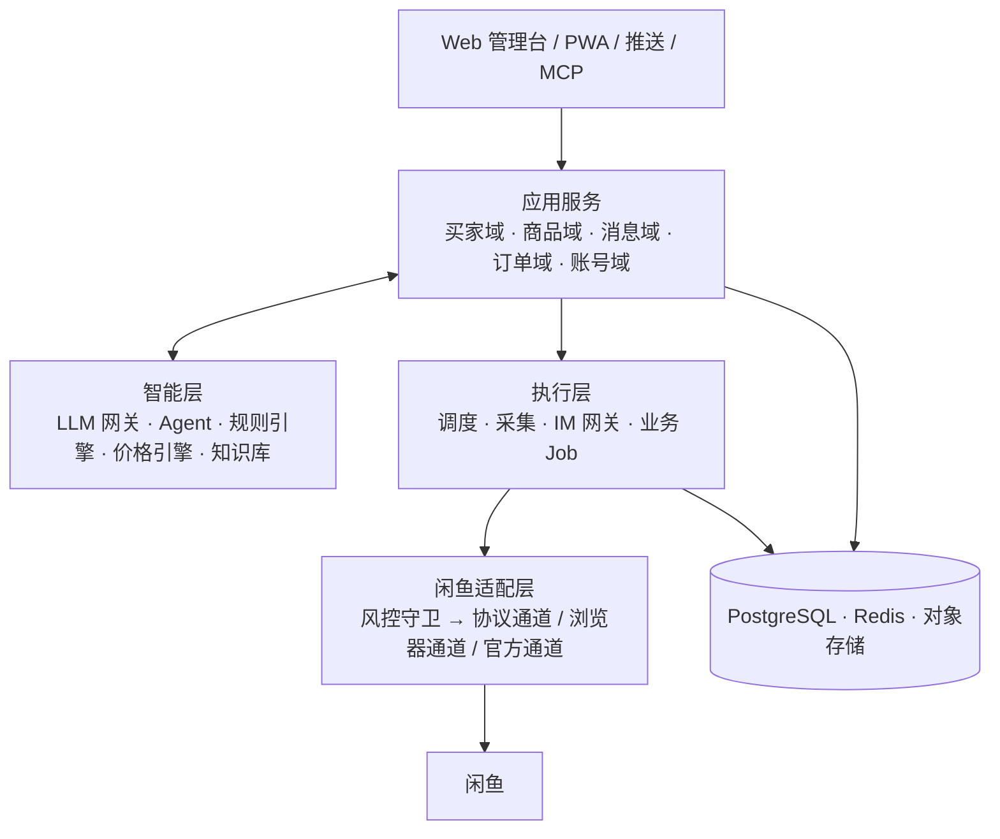

# 鱼塘管家（XianyuHub）· 闲鱼买卖双端智能平台：调研与方案

> [!NOTE]
> 本目录是项目启动前的调研与设计文档，保留原样作为决策记录。实际实现以代码和[仓库 README](../../README.md)为准，
> 主要差异：前端组件库改用 Element Plus；阶段划分合并为一次实现；多实例部署采用 Redis Pub/Sub 集群桥。

本平台同时服务买家和卖家：

- **买家端「选品雷达」**：7×24 小时监控商品，用 AI 识别好货和贩子，结合价格情报给出判断，并实时推送。
- **卖家端「店铺中枢」**：管理商品的查询、发布和定价，提供 AI 客服（带议价护栏），自动完成虚拟商品的发货和确认发货。

## 文档目录

| 文档 | 内容 |
|---|---|
| [01_开源项目调研报告.md](01_开源项目调研报告.md) | 5 个指定项目的源码级分析，外加十余个生态项目、闲鱼协议要点、社区痛点和借鉴结论 |
| [02_产品功能规划.md](02_产品功能规划.md) | 产品定位、用户画像、功能地图、**详细功能清单**（编号、优先级、风险等级、参考来源）、MVP 范围 |
| [03_系统架构设计.md](03_系统架构设计.md) | **总体架构图**、闲鱼适配层（多通道与风控守卫）、IM 网关、AI 编排与议价算法、ER 图、技术选型、目录结构、部署拓扑 |
| [04_核心业务流程图.md](04_核心业务流程图.md) | 选品雷达、自动回复、议价决策、自动发货、订单状态机、AI 发布、账号状态机、扫码登录、事件流 |
| [05_风险合规与实施路线.md](05_风险合规与实施路线.md) | 风险矩阵、甘特图路线、各阶段验收标准、技术验证清单、待决策事项 |

> 图表都用 Mermaid 编写。在 VSCode 中安装 “Markdown Preview Mermaid Support” 插件即可预览，GitHub 和 Typora 也能直接渲染。

## 架构一览

## 核心设计结论

1. **一个适配层管住所有闲鱼交互**：业务代码只调用能力接口；协议通道（快）、浏览器通道（稳）、官方开放平台（合规）三选一，并能自动降级。
2. **风控内建在调用链上**：账号锁、令牌桶、熔断、冷却、一账号一固定 IP；检测到风控就停下来，交给人工处理。
3. **AI 有护栏**：底价、让价阶梯和议价轮次由代码计算，AI 只负责组织语言；输出前校验回复中的金额、禁用词和站外联系方式。
4. **买卖数据打通**：选品雷达积累的市场价数据，同时用于卖家的智能定价和竞品监控。
5. **安全基线高于参考项目**：参考项目普遍存在接口无鉴权、cookie 明文保存的问题，本方案要求全部接口鉴权，凭证加密存储。
6. **采用净室实现**：GPL/AGPL 项目和没有 LICENSE 的项目只借鉴设计思路，不复制代码。

## 建议的推进顺序

阶段 0 技术验证 → **MVP-1 买家雷达**（风险最低）→ MVP-2 卖家 AI 客服 → MVP-3 自动发货 → V1.0 多账号与发布 → V2.0 开放 API 与 MCP、官方通道
