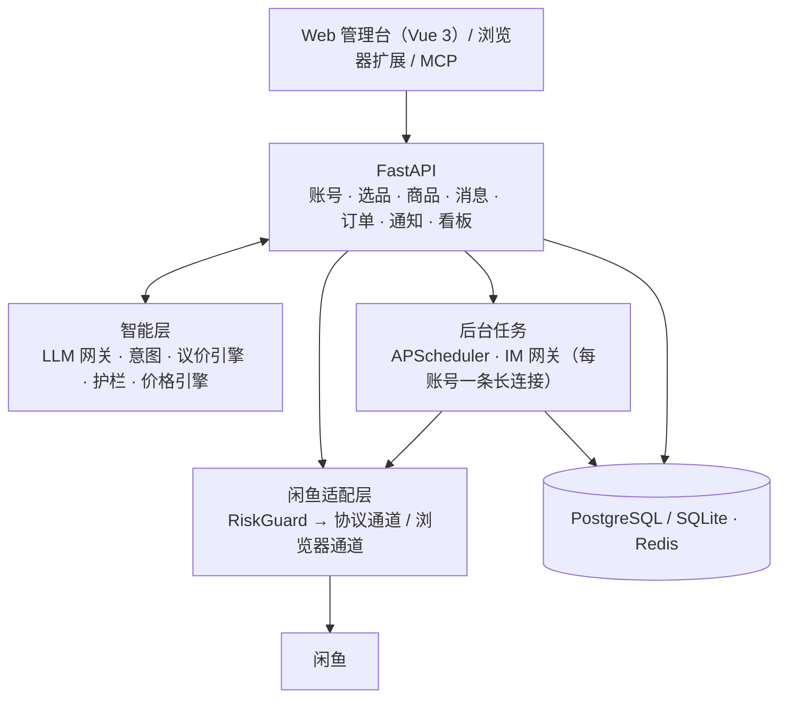

# 开发指南

## 架构



| 层 | 选型 |
|---|---|
| 后端 | Python 3.12 · FastAPI · Pydantic v2 · SQLAlchemy 2.0 async · Alembic · APScheduler · httpx · websockets · msgpack |
| 大模型 | Anthropic 官方 SDK，或任意 OpenAI 兼容接口（Qwen / DeepSeek / Kimi / GLM / Ollama / vLLM） |
| 前端 | Vue 3 · Vite · TypeScript · Element Plus · Pinia · ECharts |
| 部署 | Docker Compose · Caddy · PostgreSQL 16 · Redis 7 |

**设计要点**

1. **一个适配层管住所有闲鱼交互**（`backend/app/goofish/`）：业务代码只调用 `search_items`、`get_order_detail`、`consign_virtual` 这类能力方法；底层走协议通道（mtop 签名 + IM 长连接），匿名搜索遇到风控可降级到 Playwright 浏览器通道。接口变化时只改解析器和样本。
2. **风控是一等公民**：每次调用都经过 `RiskGuard`——账号状态检查 → 按动作的令牌桶（单机内存 / 多实例 Redis）→ 随机抖动 → 登录、发布类操作账号互斥。识别到 `FAIL_SYS_USER_VALIDATE`、`RGV587`、`punish` 等信号立即熔断并通知人工，不做任何自动破解。
3. **AI 有护栏**：AI 只负责理解和措辞；价格、发货、是否发送由规则决定。议价引擎有 1000 组随机用例的模糊测试，保证报价永不低于底价。
4. **安全基线**：所有接口强制鉴权；Cookie、代理、卡密、通知渠道配置用 AES-256-GCM 加密存储；默认只监听本机；凭证不发给任何第三方。

## 目录结构

```
XianyuHub/
├── backend/
│   ├── app/
│   │   ├── goofish/            # 闲鱼适配层（唯一出入口）
│   │   │   ├── protocol/       #   mtop 签名与客户端、IM（LWP）长连接、扫码登录、编解码
│   │   │   ├── parsers/        #   搜索 / 详情 / 卖家 / 订单 / IM 消息解析
│   │   │   ├── guard/          #   令牌桶、风控守卫、动作策略
│   │   │   ├── gateway.py      #   能力门面 + 浏览器通道
│   │   │   └── publish.py      #   发布请求体
│   │   ├── intelligence/       # LLM 网关、议价引擎、护栏、价格引擎、意图、规则
│   │   ├── domains/            # account / buyer / goods / message / order / system
│   │   ├── notify/             # 通知渠道
│   │   ├── workers/            # 调度器、IM 网关
│   │   ├── mcp_server.py       # MCP Server
│   │   └── main.py
│   ├── migrations/             # Alembic
│   └── tests/                  # 约 190 个测试
├── frontend/                   # Vue 3 管理台
├── extension/                  # 浏览器扩展
├── deploy/                     # docker-compose、Caddyfile、.env.example
└── docs/                       # 使用、部署、开发与设计文档
```

## 常用命令

```bash
cd backend
uv sync --all-extras
uv run pytest -q                                   # 测试
uv run ruff check app tests migrations             # 代码检查
uv run ruff format app tests migrations            # 格式化
uv run alembic revision --autogenerate -m "说明"    # 修改模型后生成迁移

cd frontend
pnpm install
pnpm build                                         # 类型检查 + 构建
```

## 开发约定

- 与闲鱼交互的代码只能放在 `app/goofish/` 下，业务层禁止直接发 HTTP / WebSocket 请求
- 新增闲鱼接口时，同时提交：网关方法、解析器、脱敏后的响应样本（`tests/fixtures/`）和解析测试
- 写操作必须选择对应的 `Action`（决定限流与互斥），并写入审计日志
- AI 输出必须定义 Pydantic 模型；涉及价格或发货的决策必须由规则层给出
- 提交前确认没有包含任何真实 Cookie、Token、手机号、账号 ID 或卡密
